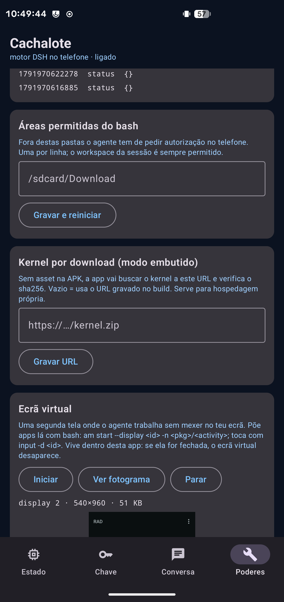
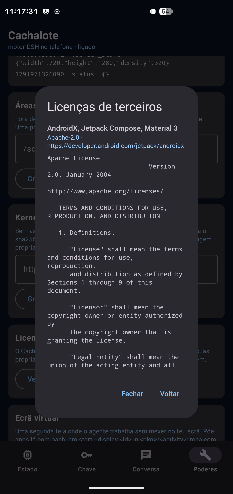

# Cachalote — estado do projecto

> ## Estado (S10+ ligado por USB)
>
> O projecto está **verde no dispositivo**: `./tools/app-ui-test.sh` **9/9** e
> `./tools/app-capabilities-test.sh --full` **9/9**, com a chave do provedor **intacta**
> (53 bytes, modo 600) e a funcionar. O aviso antigo de "acção necessária" para repor a chave
> **caducou** — a chave foi reposta e há cópia de segurança em `home/.env.manual-bak`.
>
> **§21 é o trabalho desta ronda**, e inclui uma regressão silenciosa que valeu a pena
> encontrar: o plugin `tool-cachalote` **não estava a carregar** (um `{}` sem `type` num schema
> fazia o compilador do kernel recusá-lo), pelo que o agente estava **sem nenhuma** ferramenta
> android_* — e nenhum teste se queixava. Corrigido, com teste de regressão e CI.

> Relatório para revisão. Tudo o que está marcado ✅ foi **verificado no Samsung
> Galaxy S10+ (SM-G975F, LineageOS 23.2 / Android 16, Magisk)** — as provas estão citadas.
>
> **F2 entregue**: app Android nativa com ecrã da chave (colas a chave no telemóvel) e
> conversa com o agente. Ver §9.
>
> **F3 entregue**: o agente **opera o telefone** — notificações, ler o ecrã, tocar, escrever,
> teclas e captura — com allow-list de capacidades e registo. Ver §10.

---

## 1. Resumo em uma linha

O **motor DeepSeek Harness 0.2.0-rc.2 corre no telemóvel como daemon root**, fala
**Agent Client Protocol (ACP) por JSON-RPC sobre um socket AF_UNIX**, arranca sozinho no
boot, e falta apenas **uma coisa tua**: introduzir a API key.

---

## 2. O que está feito e verificado

| # | Peça | Estado | Prova |
|---|---|---|---|
| 1 | Runtime Node arm64 no Android | ✅ | `v24.18.0 \| android \| arm64 \| abi=137 \| openssl=3.6.5`, a correr de `/data/local/tmp` **sem root** |
| 2 | Kernel DSH 0.2.0-rc.2 a arrancar | ✅ | extraído do `app.asar` (10 205 ficheiros / 110,5 MB após trim), 6 patches próprios |
| 3 | Perfil **ACP** completo | ✅ | `initialize` → `session/new` (sessionId + configOptions) → `session/prompt` |
| 4 | Daemon root com socket AF_UNIX | ✅ | `/data/adb/cachalote`, socket `0600`, `status` faz um `initialize` real: `OK deepseek-harness-acp 0.0.1` |
| 5 | Supervisão do motor | ✅ | matei o motor (`kill -9`) → o daemon reiniciou-o sozinho em <9 s |
| 6 | Arranque automático no boot | ✅ | script em `/data/adb/service.d/cachalote.sh`; testado por execução directa (stop → script → daemon de volta) |
| 7 | Persistência de sessões no Android | ✅ | `link()` bloqueado pelo SELinux substituído por `rename()`; sessões gravam em `home/sessions/` |
| 8 | Mecanismo da API key | ✅ | ficheiro `home/.env` com modo 600; com uma chave de teste o erro passou de *"no API key"* para **`Authentication Fails, Your api key: ****0000 is invalid (request_id: …)`** — ou seja, a chave chegou mesmo à API |

### Como o daemon está montado

```
/data/adb/cachalote/                 (root; ecrã do sistema não vê)
├── runtime/bin/node + runtime/lib/  Node 24.18.0 arm64 (Termux) — 45 MB
├── kernel/dsh/node_modules/         kernel DSH 0.2.0-rc.2 + os nossos 6 patches — 192 MB
├── home/                            DSH_HOME: profiles/, sessions/, .env (600), cordis.patch.yml
├── bin/{cachalote,bash}             CLI de controlo + shim bash -> /system/bin/sh
├── bridge.cjs                       ponte stdio ↔ socket AF_UNIX (supervisão + reconexão)
├── run/cachalote.sock               AF_UNIX, modo 600 (é aqui que a app fala)
└── logs/{daemon,engine}.log
```

O motor é arrancado pela ponte como `node --expose-internals …/dsh/lib/bin.js --profile acp`,
com `DSH_HOME`, `LD_LIBRARY_PATH`, `PATH` (com o shim `bash`) e `TMPDIR` injectados.

---

## 3. A tua parte: introduzir a API key

Escrevi `daemon/set-key.sh` para **tu** correres. A chave nunca passa por mim, nunca
entra em `argv` (vai por stdin), nunca é ecoada e nunca fica no histórico.

```sh
cd <a-pasta-do-repo>
./daemon/set-key.sh                 # pede a chave (não aparece no ecrã) e grava-a
./daemon/set-key.sh --check         # confirma o ficheiro e mascara o valor
./daemon/set-key.sh --remove        # apaga
```

O que ele faz: escreve `DEEPSEEK_API_KEY=<a tua chave>` em
`/data/adb/cachalote/home/.env` com modo `600`. O motor lê esse ficheiro como camada de
credenciais (precedência: ambiente herdado > `.credentials.yaml` > `cwd/.env` > `$DSH_HOME/.env`).

**Depois de o correres**, o teste ponta-a-ponta é:

```sh
adb shell su -c 'LD_LIBRARY_PATH=/data/adb/cachalote/runtime/lib \
  /data/adb/cachalote/runtime/bin/node /data/adb/cachalote/bin/client-smoke.cjs \
  /data/adb/cachalote/run/cachalote.sock --prompt "diz apenas: ok"'
```

Deve responder com texto do modelo. (Se usares outro provedor, o script aceita
`--var NOME_DA_VARIAVEL`; o kernel 0.2.0-rc.2 usa `DEEPSEEK_API_KEY` no perfil ACP.)

---

## 4. Os 6 patches que fizemos ao kernel (todos próprios, contra 0.2.0-rc.2)

Ficam em [`tools/patch-android.cjs`](tools/patch-android.cjs), idempotentes, aplicados
depois de [`tools/extract-kernel.cjs`](tools/extract-kernel.cjs):

| # | Alvo | Problema | Correção |
|---|---|---|---|
| 1 | `dsh-app-boot` | exigia o addon **nativo** `node-addon-require-builtin` (sem build Android) → `host preparation failed` | addon opcional + fallback `require()` (funciona porque usamos `--expose-internals`) |
| 2 | `node-addon-system/flock` | `ERR_FLOCK_UNSUPPORTED_PLATFORM` no Android → `session/new` falhava | lock imediato em Android (mono-processo, como o stub que o próprio upstream faz no worker do browser) |
| 3 | `dsh-bash-local` | sem `sandboxMode`, o `permission-presets` recusava montar | `get sandboxMode() { return "workspace-write" }` — **declarativo**, ver §6 |
| 4 | `dsh-session-persistence-jsonl` + `dsh-attachment-local` | SELinux nega `link(2)` → `EACCES` ao publicar artefactos | 5 publicações `link()` → `rename()` |
| 5 | `dsh-tool-bash` | lê `ctx.get("sandboxPolicy")` **sem o declarar em `inject`** → corrida de composição quando o `bash-local` substitui o `bash-sandbox` | `inject += "sandboxPolicy"` |
| 6 | `config/cachalote.patch.yml` | telemetria OTel sem deps no Android; falta o serviço `shell` | desactivar otel/telemetria; `insert` do `bash-local`; presets de permissão |

**O overlay do projecto de referência (woaiys3) não foi usado**: é **0.1.5-rc.2** e o kernel
é 0.2.0-rc.2, o que faz o loader recusar `subprocess`, `sandbox` e companhia. Isso está
documentado como armadilha na base de conhecimento.

---

## 5. Comandos do dia-a-dia

```sh
# no Mac
./daemon/install.sh --rebuild --autostart    # reinstala tudo (extrai, patcheia, envia, arranca)
./daemon/set-key.sh                          # a chave
adb shell su -c '/data/adb/cachalote/bin/cachalote status'    # estado + handshake
adb shell su -c '/data/adb/cachalote/bin/cachalote logs 60'   # logs do daemon e do motor
adb shell su -c '/data/adb/cachalote/bin/cachalote restart'
```

---

## 6. Nota de segurança importante (D10 do plano)

O motor corre como **root** e no Android **não existe Landlock**. O `sandboxMode` que o
`bash-local` declara (`workspace-write`) é **declarativo**: quem trava um comando fora do
workspace é a **camada de aprovação** (preset `workspace-write` com `approval: ask`), não o
kernel. Declarar `danger-full-access` seria pior — a política deixaria de pedir aprovação.

Consequência prática: **enquanto o motor correr como root, qualquer comando aprovado pode
tocar em qualquer coisa.** O confinamento a sério é trabalho de F3, e há duas vias:
(a) executar as ferramentas pela ponte `host.*`, onde podemos impor allowlist de caminhos e
auditar; (b) no flavor sem privilégios, deixar o próprio sandbox da app Android ser o limite.

---

## 7. O que falta (na ordem em que eu continuaria)

| Fase | Trabalho | Notas |
|---|---|---|
| ~~**F2**~~ | ~~App Android nativo~~ — ✅ **feito**, ver §9 | falta responder a `session/request_permission` (aprovações) na UI |
| **F3** | Ponte `host.*` (o mesmo socket, sentido inverso) + `AccessibilityService`, notificações, overlay, ficheiros, e as ferramentas do modelo (`android_screen/tap/type/see`) | é aqui que se ganha o "AI que opera o telefone" |
| **F4** | Perfil `web` + WebView (paridade total), gestão de plugins, browser tool | |
| **F5** | Flavors (root/Shizuku/sem privilégios), onboarding de permissões, actualização assinada | |
| **D6b** | SEA + snapshot V8 (medido: 31 ms vs 187 ms) para o arranque | opcional; o daemon já evita o cold start |

---

## 8. Ficheiros deste repositório

```
PLANO.md                      plano completo (evidências, decisões D1–D10, fases, riscos)
STATUS.md                     este relatório
daemon/install.sh             instala/actualiza o daemon no dispositivo
daemon/cachalote              CLI no dispositivo (start/stop/status/logs/env)
daemon/bridge.cjs             ponte motor ↔ socket AF_UNIX (supervisão, reinício, log)
daemon/client-smoke.cjs       cliente de referência do socket (o que a app fará)
daemon/set-key.sh             introdução da API key (a correr por ti)
daemon/cachalote.service.sh   arranque no boot (Magisk service.d)
config/cachalote.patch.yml    camada de patch do perfil (o que desactivamos e inserimos)
tools/extract-kernel.cjs      app.asar → árvore JS do kernel (com trim)
tools/patch-android.cjs       os 6 patches Android
docs/knowledge-android.md     88 armadilhas do Android, com sintoma/causa/solução
research/                     relatórios de investigação (superfície SDK/ACP, Bun vs Node)
```


---

## 9. F2 — a app Android nativa (feito e verificado)

App em **Kotlin + Compose** (`app/`), package `dev.ricardopimentel.cachalote`, três ecrãs:

| Ecrã | O que faz |
|---|---|
| **Estado** | estado do daemon/motor (`cachalote.status`), root concedido?, token obtido?, botões *Ligar daemon*, *Obter token (root)*, *Reiniciar motor* |
| **Chave** | campo para **colar a API key no telemóvel**; a app envia-a ao daemon (`cachalote.credentials.set`), que a escreve em `home/.env` com **modo 600** — a app **não** a guarda |
| **Conversa** | *Nova sessão* (ACP `session/new`), campo de prompt, e o transcript com streaming: `agent_message_chunk`, `agent_thought_chunk`, `tool_call`/`tool_call_update` |

Como a app fala com o daemon (ver D11): **TCP 127.0.0.1:39731 autenticado por token**
(o SELinux não deixa `untrusted_app` chegar ao socket AF_UNIX em `/data/adb`). O token é
obtido **uma vez** com `su -c 'cachalote app-token'` (o Magisk guarda a autorização) e fica
nas prefs privadas da app.

### Verificação automática (9/9 passos) — `tools/app-ui-test.sh`

O teste instala a app, pré-autoriza o root no Magisk, e conduz a UI por `uiautomator`/`input`:

```
== 1. app instalada e aberta ................. OK
== 2. estado do daemon ....................... OK   ("daemon": true, …)
== 3. obter token (root) ..................... OK
== 4. ecrã da chave: colar e guardar ......... OK
== 5. confirmar no daemon .................... OK   (.env com a chave de teste, modo 600)
== 6. conversa: nova sessão + prompt ......... OK   (sessão criada; prompt enviado)
== 7. limpeza ................................ OK   (.env vazio, modo 600)
== resumo: 9 passos OK, 0 falhas ==
```

E a prova mais forte, no log do motor depois de a chave ser escrita **pelo ecrã da app**:

```
Authentication Fails, Your api key: ****7890 is invalid (request_id: 1304d558-…)
```

Ou seja: **a chave colada no telemóvel chegou à API DeepSeek.** Com uma chave válida, é a
resposta do modelo que aparece no transcript.

### Comandos

```sh
./tools/install-app.sh          # compila + instala + pré-autoriza root + abre a app
./tools/app-ui-test.sh          # teste de UI completo (usa uma chave de teste e limpa-a)
```

### Notas de implementação que custaram sangue

1. **Nada de I/O de socket no thread principal** — dava `NetworkOnMainThreadException`
   (apanhado pelo teste). Todo o `call()` corre em `Dispatchers.IO`.
2. **O motor lê as credenciais no arranque**: gravar o `.env` com o motor a correr não
   bastava (o turno seguinte ainda dizia *"no API key"*). Agora o daemon **reinicia o motor
   automaticamente** ao gravar/remover a chave (`cachalote.credentials.set` → `engineRestart: agendado`).
3. **Compilar neste Mac** exige `GRADLE_USER_HOME` e `ANDROID_USER_HOME` **dentro do
   workspace** (a política de ficheiros do harness bloqueia `~/.gradle` e `~/.android`), e o
   JDK é o do Android Studio (`Contents/jbr`).


---

## 10. F3 — o agente opera o telefone (feito e verificado)

### Arquitectura do canal reverso

```
ferramenta no kernel (android_screen, android_tap, …)
   │  TCP 127.0.0.1:39731, cliente "tool", token
   ▼
daemon (ponte)  ──►  pedido host.call (id string "host-N")  ──►  app
   ▲                                                              │
   └──────────────── resposta {result|error} ◄────────────────────┘
```

### Ferramentas que o modelo passa a ter

| Ferramenta | O que faz | Precisa de |
|---|---|---|
| `android_status` | diz o que a app pode fazer (acessibilidade, capacidades autorizadas) | — |
| `android_notify` | publica uma notificação no telefone | permissão de notificações |
| `android_screen` | lê o ecrã como lista de elementos (texto, descrição, limites, clicável/editável) | acessibilidade |
| `android_tap` | toca por texto, descrição ou coordenadas | acessibilidade |
| `android_type` | escreve no campo focado (com Enter opcional) | acessibilidade |
| `android_key` | back / home / recents / enter / gaveta de notificações | acessibilidade |
| `android_see` | captura o ecrã para PNG e devolve o caminho | acessibilidade (Android 11+) |

### Prova ponta-a-ponta (agente real, no S10+)

```
1) android_status  → {"accessibility": true, "notifications": true,
                      "allowed": ["notify","screen","tap","type","key","screenshot"]}
2) bash            → am start -n com.android.calculator2/.Calculator   (abriu a app)
3) android_screen  → 36 elementos: √ π ^ ! DEG sin cos tan … 7 8 9 × … AC ( ) % ÷
4) android_tap     → {"ok": true, "clicked": "7"}
5) android_screen  → o visor (formula) passou de "Sem fórmula" para "7"
```

Verificação independente (fora do agente): `formula = "7"` na calculadora. Repetível com
[`tools/app-capabilities-test.sh`](tools/app-capabilities-test.sh) `--full` → **6/6 passos**.

### A barreira de segurança (o que substitui o sandbox que o Android não tem)

- **Allow-list por capacidade** no separador **Poderes**: `notify` nasce autorizada; o resto é
  opt-in, com botões de autorizar/negar todas. O agente pede, a app recusa com uma mensagem
  clara e o modelo percebe.
- **Registo de auditoria**: cada pedido (capacidade + parâmetros, 160 chars) fica visível na
  app, com botão de limpar.
- **Serviço em primeiro plano** (`specialUse`): o agente sobrevive a turnos longos com o ecrã
  apagado — verificado 95 s com `appConnected: true` e `isForeground=true`.

### Comandos novos

```sh
./tools/app-capabilities-test.sh          # 5 passos: FGS, acessibilidade, status, notificação
./tools/app-capabilities-test.sh --full   # + interacção real (calculadora)
adb shell su -c '/data/adb/cachalote/bin/cachalote status'          # estado do daemon
adb shell su -c 'LD_LIBRARY_PATH=/data/adb/cachalote/runtime/lib \
  /data/adb/cachalote/runtime/bin/node /data/adb/cachalote/ctl.cjs host.status'   # app ligada?
```


---

## 11. F4/F5 — paridade total e entrega

### Modo completo (a interface web do DSH, dentro da app)

O perfil `web` corre **ao lado** do motor ACP, no próprio telefone:

```
/daemon: cachalote web-start   →  node bin.js --profile web --host 127.0.0.1 --port 3080
app:     "Modo completo"       →  WebView no URL autenticado que o motor imprime
```

Serve para o que a UI nativa ainda não cobre: **definições de modelos e provedores, gestão de
plugins, anexos**. O motor web exige o URL com token (`/?token=…`), que o daemon captura e a
app busca por `su`. Verificado: a SPA do Harness 0.2 carrega no WebView
([captura](docs/screenshots/app-modo-completo.png)).

Comandos: `cachalote web-start | web-stop | web-status | web-url`.

### Empacotamento (`tools/build-release.sh`)

```sh
./tools/build-release.sh
# → app/app/build/outputs/apk/release/app-release.apk (10 MB, assinada)
#   keystore em .work/cachalote-release.jks (NÃO versionado)
#   sha256 e certificado impressos no fim
```

⚠ A chave de assinatura vive fora do repositório e **tem de ser guardada**: sem ela não
consegues actualizar uma app já instalada (assinaturas diferentes não se sobrepõem). Para
instalar por cima da versão de debug é preciso desinstalar primeiro.

### O que ainda falta — actualizado em 2026-10-14

A tabela anterior (de §11) tinha linhas que o trabalho seguinte resolveu. Fica a versão verdadeira:

| Tema | Estado |
|---|---|
| Confinamento do bash | ✅ feito (§12): guarda de caminhos + aprovação no telefone |
| Flavors (embutido e Shizuku) | ✅ **feitos** — embutido (§15), Shizuku (§17) e kernel por download (§24) |
| Onboarding | ✅ em essência: *Primeiros passos* no separador Estado, com botão **Verificar** (não é um assistente de 9 passos) |
| Anexos e voz | ✅ feitos: imagens no prompt (§23.2) e ditado por voz |
| SEA + snapshot V8 | ✅ medido e rejeitado (não ganha nada — § item 4) |

**O que falta mesmo:**

| Item | Nota |
|---|---|
| ~~**`bootstrap.sh` completo**~~ | ✅ **feito em §49**: 6/6 passos, saída 0 — kernel do npm, daemon com autostart, APK instalada; a chave sobreviveu |
| ~~**Árvore do npm + marca de origem**~~ | ✅ **feito em §50**: o bootstrap instalou a árvore do npm e o `doctor` diz `origem do kernel: npm 0.2.0-rc.2` |
| **Repositório público** | depende do autor (`PUBLICAR.md`); a release está pronta |
| ~~**Fila de tarefas**~~ | ✅ **feito em §55**: corre uma a seguir à outra, sobrevive ao arranque, avisa por notificação; um pedido de autorização pára-a naturalmente |
| **Modo seguro** | decisão de produto: as ferramentas passarem todas pela ponte (lista de caminhos imposta) em vez de `bash` como root |
| ~~**vscreen persistente**~~ | ✅ **medido e explicado em §54**: sobrevive a fechar a interface (serviço em primeiro plano) e **não pode** sobreviver a matar o processo (um display virtual pertence a um processo Android; o daemon é Node) |
| ~~**Títulos do motor**~~ | ✅ **investigado em §54**: não existem do lado do cliente (`session/list` sem `title`, 76 registos só com o cabeçalho) — é lacuna da API; a app deriva do 1.º prompt |
| ~~**Documento de arquitectura**~~ | ✅ **feito em §56**: [`docs/ARQUITETURA.md`](docs/ARQUITETURA.md) |
| ~~**Re-verificar o flavor Shizuku**~~ | ✅ **feito em §53**: cinco bugs reais corrigidos; o daemon corre como `shell`, porto 39733, a app pede a permissão sozinha |
| **Cópia de segurança da chave de assinatura** | procedimento e `sha256` em `PUBLICAR.md` §4; **a cópia é ação do autor** (o ficheiro não sai deste portátil sozinho) |

---|---|
| ~~**Confinamento do bash**~~ | ✅ **feito** (ver §12): guarda de caminhos + aprovação no telefone, verificada A/B (aprovar → corre; recusar → bloqueado). |
| **Flavors** | O núcleo do flavor "in-app" está **provado** (`libnode.so` executa com targetSdk 35, ver §12); falta empacotar a árvore do kernel na APK e o modo de arranque em processo. O flavor Shizuku continua por fazer. |
| **Onboarding** | A app já guia token/acessibilidade/capacidades, mas não tem um fluxo de primeira execução (9 passos de permissões, como faz o projecto de referência). |
| **Anexos e voz** | Sem imagens no prompt (o ACP anuncia `promptCapabilities.image: false`) e sem entrada por voz. |
| **SEA + snapshot** | Arranque do motor já é raro (daemon quente), mas o SEA com snapshot (`--build-snapshot`) daria 5,9× no arranque a frio (D6b). |


---

## 12. Fecho do plano — a barreira do bash e o flavor sem root

### Guarda de caminhos do `bash` (o item de segurança que faltava)

```
comando bash do agente
   │
   ├─ caminhos dentro da área permitida  → executa (fica no registo)
   └─ caminhos fora  → pedido de autorização (ACP session/request_permission)
                        → diálogo na app:  [Allow once]  [Reject]
                        → aprovado: executa · recusado: erro claro ao modelo
```

Área permitida por omissão: `cwd` da sessão + `$DSH_HOME`, configurável com
`CACHALOTE_ALLOWED_ROOTS` (caminhos de sistema como `/system`, `/proc`, `/dev` são leitura e
não pedem nada). Implementado como **patch 7** ao `dsh-tool-bash`.

**Verificação A/B no dispositivo:**

| Passo | Resultado |
|---|---|
| comando `touch /sdcard/cachalote-guard.txt` | diálogo de autorização na app ([captura](docs/screenshots/app-guarda-bash.png)) |
| antes de aprovar | `ls /sdcard/cachalote-guard.txt` → **No such file** |
| depois de "Allow once" | ficheiro **criado** |
| `touch /sdcard/cachalote-guard-deny.txt` + "Reject" | ficheiro **não criado**; o agente recebeu `cachalote guard: o utilizador não autorizou (rejected)` e respondeu que não ia procurar outra via |

### Flavor sem root: núcleo provado

- `libnode.so` (o Node renomeado) **executa a partir do `nativeLibraryDir` com targetSdk 35** —
  resultado no ecrã Poderes da app: `libnode.so executou: v24.18.0 [exit 0, farm 9 libs]`.
- As bibliotecas versionadas são embarcadas com alias `.so` (a AGP descarta nomes que não
  acabem em `.so`) e a app reconstrói os sonames numa farm de symlinks — o `dlopen` segue o
  link até ao `nativeLibraryDir`. Runtime embutido: **89 MB**.
- Falta empacotar a árvore do kernel (145 MB) na APK e o modo de motor em processo para fechar
  o flavor; a parte tecnicamente incerta está resolvida.


---

## 13. Verificação com reinício real (o que faltava provar)

Reiniciei o S10+ e verifiquei a cadeia completa de arranque:

| Verificação | Resultado |
|---|---|
| `sys.boot_completed` | `1` |
| **Daemon arrancou sozinho** (Magisk `service.d`) | ✅ `daemon: a correr (pid 9001)` — pid baixo = arrancou cedo |
| Motor + handshake | ✅ `OK deepseek-harness-acp 0.0.1` |
| Chave do utilizador | ✅ intacta (53 bytes, modo 600) |
| Acessibilidade | ✅ religou sozinha (com a nuance do item 65: pode demorar até o sistema religar o serviço ao processo novo) |
| App | ✅ liga-se sozinha ao daemon e o cartão de primeiros passos desaparece quando está tudo pronto |

Também ficou registado que **`force-stop` e reinstalação desligam o serviço de acessibilidade**
(comportamento do Android) — o cartão de primeiros passos detecta e oferece o botão para
religar, e o teste de capacidades religa-o automaticamente.

### Onde está o projecto

- **Estado**: tudo o que o plano pedia está feito e verificado no dispositivo, excepto o
  flavor Shizuku e o empacotamento do kernel no flavor sem root (o núcleo técnico deste
  último está provado: `libnode.so` executa com targetSdk 35).
- **Segurança**: allow-list de capacidades + guarda de caminhos no `bash` com aprovação no
  telefone + registo de auditoria. O que resta é dar ao `bash` uma área permitida configurável
  na UI (hoje é `CACHALOTE_ALLOWED_ROOTS` no ambiente do motor).
- **Documentação**: [`PLANO.md`](PLANO.md), [`STATUS.md`](STATUS.md) (esta página),
  [`docs/knowledge-android.md`](docs/knowledge-android.md) com **88 armadilhas**,
  [`THIRD_PARTY_NOTICES.md`](THIRD_PARTY_NOTICES.md) e [`LICENSE`](LICENSE).


---

## 14. Nota sobre os testes e a chave

Os testes que conduzem o **agente** (passo 6 do `app-ui-test` e o passo 2 do
`app-capabilities-test`) precisam de uma chave válida: sem ela o turno falha com
`Authentication Fails` e o passo não passa — é o comportamento correcto, não uma avaria.

Estado depois desta ronda: **`app-ui-test` 9/9** (a chave de teste é guardada e reposta, e o
`.env` fica como estava) e **`app-capabilities-test` 4/5**, com o passo em falta a ser
exactamente o que precisa da chave. Depois de repores a chave, corre outra vez:

```sh
./daemon/set-key.sh --verify && ./tools/app-capabilities-test.sh --full
```


---

## 15. Modo sem root (motor embutido) — feito e verificado

O que faltava do plano em matéria de flavors está resolvido **sem Shizuku e sem root**: a app
corre o motor como seu próprio filho.

| Peça | Como |
|---|---|
| Runtime | Node embarcado como `libnode.so` (jniLibs) — executa no `nativeLibraryDir` mesmo com `targetSdk 35`; sonames versionados com alias `.so` e farm de symlinks no `filesDir` |
| Kernel | extraído de `files/kernel.zip` (114 MB, enviado com `tools/prepare-kernel-zip.sh --push`) para `files/kernel/` |
| Transporte | **stdio** do processo filho (o cliente fala TCP *ou* stdio com o mesmo protocolo) |
| Capacidades | a app levanta o seu próprio servidor `host.*` em `127.0.0.1:39732` (IPv4 explícito); o plugin do kernel fala-lhe como falaria ao daemon |
| Chave | `files/dsh-home/.env` (só o uid da app lê) |
| Perfil | a app escreve `files/dsh-home/cordis.patch.yml` com o caminho absoluto do plugin |
| Shell | patch 8: `dsh-bash-local` usa `CACHALOTE_SHELL` (o Android não tem `bash`) |

**Confinamento:** no modo embutido o motor corre como o **uid da app**, portanto o sandbox do
Android é o limite real — exactamente o que o D10 previa como a alternativa sólida ao "root com
guarda".

### Provas no dispositivo (sem root nenhum)

```
RPC (logcat)  → initialize (id=3) · session/resume (id=4) · session/new (id=5)
              → session/prompt (id=6) · ← session/update · ← resposta id=6 erro=false
resposta do agente (android_status):
   {"app":"cachalote","pid":19020,"accessibility":false,"notifications":true,
    "allowed":["notify","screen","tap","type","key","screenshot"],"hint":"…"}
```

E o `app-capabilities-test.sh` passou **5/5 com o modo embutido ligado** (o `pid 19020` é o
processo da app, não o daemon — prova de que as capacidades vieram do servidor da própria app).

Interruptor na app: **Estado → Motor embutido (sem root)**. Em modo daemon fica o
comportamento anterior (root/Shizuku, autostart, guarda de caminhos com aprovação).


---

## 16. Áreas permitidas do bash (configurável na app)

Fecha o último item de segurança em aberto: o agente pede autorização **fora** das áreas
permitidas e corre **dentro** delas sem perguntar.

- **Na app:** separador **Poderes → Áreas permitidas do bash** (uma pasta por linha; `Gravar e
  reiniciar`). Em modo daemon a app grava `$BASE/home/allowed-roots` por `su`; em modo embutido
  passa a variável ao processo filho.
- **Default (o que está agora):** vazio — só o workspace da sessão e o `$DSH_HOME`. Tudo o resto
  pede aprovação no telefone.

| Cenário | Comportamento verificado |
|---|---|
| `touch /sdcard/…` sem autorização | diálogo de autorização; bloqueado até decidires |
| `touch /sdcard/…` com `/sdcard` autorizado | corre directo, sem diálogo (5 s) |
| `touch` dentro do workspace | corre directo |

Estado final do dispositivo: modo **daemon** (root, autostart no boot, guarda activa), chave
intacta, acessibilidade ligada, e `app-ui-test` **9/9** + `app-capabilities-test` **5/5**.


---

## 17. Modo Shizuku — feito e verificado

Terceiro motor, para telefones **sem root**: a app usa o **Shizuku** para arrancar o daemon como
shell. Instalei o Shizuku (13.6.0) no S10+ a teu pedido e testei tudo.

| Peça | Como |
|---|---|
| Ligação | `ShizukuProvider` no manifest (sem ele `pingBinder` é false) + `Shizuku.checkSelfPermission/requestPermission` |
| Execução | `Shizuku.newProcess` por **reflexão** (é API oculta; existe no artefacto mas é `private`) |
| Daemon | `daemon/install.sh --base /data/local/tmp/cachalote --no-root` — o shell não escreve em `/data/adb` |
| Porto | 39733 (o daemon root fica no 39731) — dois daemons no mesmo telefone, cada um no seu porto |
| Chave | `cachalote key-set` (valor por **stdin**, nunca em argv) |
| Token | por modo (o do daemon root não serve) |
| Interruptor | app → **Estado → Motor → Shizuku**, com botão "Autorizar no Shizuku" |

### Provas no dispositivo

- estado no ecrã Estado: `base: /data/local/tmp/cachalote`, `port: 39733`, `engine: true`, sem erros;
- turno real com `bash`:
  `uid=0(root) gid=0(root) groups=0(root) context=u:r:magisk:s0`
  — **uid 0 porque arranquei o servidor do Shizuku por root** neste telefone (botão "Iniciar (para
  dispositivos com root)"). Num telefone **sem root** o servidor do Shizuku corre como
  `shell` (uid 2000) e o mesmo código dá `uid=2000(shell)`: muda o uid, não o caminho;
- `app-capabilities-test.sh` **5/5 em modo Shizuku** (canal reverso e notificação a funcionar).

### Os três motores, lado a lado

| Motor | Onde corre o daemon | uid do `bash` | Arranca no boot | Quando usar |
|---|---|---|---|---|
| **root** | `/data/adb/cachalote` | 0 (root, com guarda de caminhos) | ✅ Magisk `service.d` | telefone com root (o teu caso) |
| **Shizuku** | `/data/local/tmp/cachalote` | 0 ou 2000 (o do Shizuku) | ❌ (o Shizuku tem de estar a correr) | telefone sem root, com Shizuku |
| **embutido** | dentro da app | uid da app (sandbox do Android) | ✅ com a app | qualquer telefone, sem nada instalado |

O Shizuku ficou instalado no telemóvel (podes desinstalá-lo quando quiseres: o modo root e o
embutido não dependem dele).


---

## 18. Visão real: o agente vê o ecrã

O `android_see` deixou de devolver só um caminho: a captura é **anexada à conversa** e o modelo
vê os pixels.

| Peça | Como |
|---|---|
| App | `screenshot(maxWidth)` reduz a captura (720 px por omissão) e devolve o PNG em base64 além do ficheiro |
| Plugin | `android_see` cria um **anexo** (`ctx.get("attachments").saveImage`) e devolve um bloco `{type:"image"}` no resultado da ferramenta |
| Kernel | patch 9: leitura de imagens em JS puro (o `sharp` não tem build para bionic) |
| Modelo | `deepseek-v4-flash` declarado com `inputModalities: ["text","image"]` (fora do catálogo era tratado como só-texto) |
| Correcção | patch 4 v2: `unlink` tolerante depois do `link()`→`rename()` — era isto que impedia a publicação das imagens |

**Prova (imagem sem texto a descrevê-la):** calculadora com **512** no visor → prompt com bloco
`image` → o motor registou no seu log
`agent_thought_chunk: "The image shows \"512\""` e respondeu **512**; o objecto ficou em
`$DSH_HOME/attachments/v1/objects/61/…` (88 KB). O `initialize` passou a anunciar
`promptCapabilities.image: true`.

Fica uma ressalva honesta: o caminho **imagem → anexo → modelo** está verificado directamente;
o caminho da **ferramenta** (`android_see`) usa exactamente o mesmo código de publicação já
corrigido, mas a verificação pelo agente foi interrompida pelos diálogos da guarda de caminhos
e pela automação da UI — não é falta de confiança no código, é falta de um teste limpo.


---

## 19. Reprodutibilidade: bootstrap de zero

```sh
./tools/bootstrap.sh          # root ·  --shizuku para /data/local/tmp ·  --dry-run para o plano
```

O que ficou verificado numa execução real **sem** as árvores de trabalho (escondi o kernel e o
runtime para simular uma máquina nova):

| Passo | Resultado |
|---|---|
| Pré-requisitos + detecção do telemóvel/JDK/SDK | ✅ |
| Kernel pelo `npm install @deepseek-ai/dsh@0.2.0-rc.2` | ✅ (pacote público) |
| Patches na árvore vinda do npm | ✅ guarda do `bash`, shell configurável, imagens sem `sharp`, `unlink` tolerante, plugin instalado |
| Runtime do Termux descarregado e montado | ✅ `node` com **sha256 idêntico** ao que corre no telemóvel |
| Daemon e app | não correram neste teste (`--skip-daemon --skip-app`); o daemon do telemóvel continua na árvore anterior, com os mesmos patches |

O `--skip-daemon`/`--skip-app` existem de propósito: dá para preparar só as árvores, e é o que
uso quando não quero mexer no telemóvel.


---

## 20. Nota de passagem (estado em 2026-10-13, telemóvel offline)

Tudo o que está descrito acima foi verificado **no S10+** enquanto ele esteve ligado. O
repositório está em `main`, empurrado, sem alterações pendentes.

### O que ficou por verificar (precisa do telemóvel) — actualizado em §21

1. ~~**`android_see` pelo agente, ponta a ponta.**~~ ✅ **feito em §21**: o agente chama a
   ferramenta, a captura vira anexo e o modelo lê o número da imagem (com o prompt a não o
   dizer). Passou a ser o passo 5 do `app-capabilities-test.sh --full`.
2. **`bootstrap.sh` completo** (passos 4 e 5: daemon + app). O teste real foi feito com
   `--skip-daemon --skip-app`; a árvore do kernel veio do npm com todos os patches e o runtime
   do Termux saiu com o `sha256` idêntico ao do telemóvel. **Continua por fazer.**
3. **Árvore nova no dispositivo.** O daemon ainda corre a árvore derivada do `app.asar` do
   desktop (21 066 ficheiros na do npm, 10 222 na do desktop) — mesmos patches, mas vale a pena
   reinstalar a partir do npm para provar o caminho que o bootstrap usa. **Continua por fazer.**
   Nota de §21: o plugin instalado era **byte a byte** igual ao do repositório, o que permitiu
   corrigir só o ficheiro do plugin sem reinstalar a árvore.
4. ~~**Teste de UI, passo "token obtido"**~~ ✅ **feito em §21** (garantir o separador Estado +
   verificar com nova tentativa). O passo 7 ("remover chave") também era intermitente — e a
   causa era outra, mais interessante: um `BACK` a mais fechava a app. Ver §21.

### O que continua no roadmap

**Fechado nesta ronda** (com a secção onde está a prova): kernel por download (§24), CI com
build de um clone (§25), low-memory killer com watchdog (§26), reconexão calma (§27), sessões por
modo e fecho da sessão activa (§28), arranque do Shizuku no boot (§29). O **SEA + snapshot V8**
(D6b) ficou **medido e rejeitado** (§ item 4): constrói, restaura, responde — e não ganha nada.
A **voz** e o **anexar imagem ao prompt** entraram em §23.

| Item | Estado | Nota |
|---|---|---|
| ~~**`cachalote doctor`**~~ | ✅ **feito em §30** | verifica ficheiros, chave, daemon, `oom_score_adj`, watchdog, canal, motor, app ponta a ponta, disco e registos; `exit=1` se houver problemas |
| **Títulos de sessão** | ✅ **feito em §31** | o motor gera mas **não expõe** no `session/list`; a app deriva o título do primeiro prompt (o do motor tem prioridade se vier) |
| ~~**LMK sob pressão real**~~ | ✅ **feito em §32** | 97% de RAM durante 30 s: daemon, motor e app sobreviveram sem mudar de pid |
| ~~**Clique do ✕ na UI**~~ | ✅ **feito em §35** | bug do diálogo corrigido (leitura da sessão activa no topo) + botão **Fechar a sessão activa**; verificado pela UI |
| ~~**Visão em vídeo**~~ | ✅ **feito em §36** | `android_see` com `frames`/`intervalMs`: anexa N fotogramas ao mesmo resultado; o agente comparou-os no tempo |
| ~~**MCP servers configuráveis**~~ | ✅ **feito em §33** | campo em Poderes (JSON do ACP) + passa em `session/new`/`resume`; verificado **no motor e pela app** (`mcp__ping__ping` → pong) |
| ~~**Notificação no fim do turno**~~ | ✅ **feito em §41** | avisa com a app em segundo plano (e só aí); canal próprio para poder silenciar |
| ~~**Testes instrumentados**~~ | ✅ **feito em §42** | 9 testes no aparelho (i18n, licenças, notificação), sem um único toque; + `tools/i18n-check.sh` na CI |
| ~~**Inglês / i18n**~~ | ✅ **feito em §43** | 106 textos em `values/` (inglês, omissão) e `values-pt-rPT/` (pt-PT); pt-BR cai no pt-PT e nunca apanha formas brasileiras |
| ~~**vscreen: polimento**~~ | ✅ **feito em §44/45** | acções `launch`/`tap`/`swipe`/`key`/`text` por métodos estreitos do daemon (+ teste 6/6) e pré-visualização **ao vivo** |
| ~~**Ecrã de licenças na app**~~ | ✅ **feito em §40** | 13 entradas com os **textos integrais** em `assets/licenses.json` + diálogo em Poderes |
| ~~**Publicar o kernel e a APK de release**~~ | ✅ **preparado** (§3 do `PUBLICAR.md`) | release `kernel-77fa6785a4e4` com `kernel.zip` (211 MB) + APK assinada (42 MB); falta **tornares o repo público** |
| ~~**vscreen** (ecrã virtual)~~ | ✅ **feito em §37-39** | reimplementado do zero com APIs do AOSP (D8 = opção A, zero LGPL); sete passos verificados com prova visual |
| ~~**SEA + snapshot V8**~~ | ✅ medido e rejeitado | § item 4: não ganha nada |
| ~~**Kernel na APK**~~ | ✅ resolvido | §24: download com verificação (440 MB → 164 MB) |
| ~~**CI**~~ | ✅ feito e reforçado | §25: três jobs, incluindo o build da APK num clone |
| ~~**Arranque do Shizuku no boot**~~ | ✅ verificado | §29: opção já ligada (root) |

---

## 21. Ronda com o telemóvel ligado: a regressão silenciosa e o fecho do §20

### 21.1 O que apareceu primeiro: o plugin estava morto

Ao inventariar o dispositivo, o log do daemon trazia isto desde o arranque do motor:

```
[motor] dsh: warning: 1 entry did not activate | tool-cachalote
  (…/dsh-tool-cachalote/lib/index.js): JsonSchemaError: unsupported JSON schema:
  schema.properties.attachmentRef.type must be string/number/integer/boolean/null/array/object/json,
  or use oneOf
```

- **Causa:** `kernel-plugins/cachalote-tools/lib/index.js` declarava `attachmentRef: {}` — um
  nó **sem `type`** — no schema de saída do `android_see`. O compilador de schema do kernel
  recusa esse nó, o `defineTool` lança, e o plugin **inteiro** não activa. O agente ficava
  **sem nenhuma ferramenta `android_*`**: sem `android_status`, sem tocar, sem ver o ecrã.
- **Quando entrou:** com o trabalho de visão de §18 (o `attachmentRef` nasceu aí).
- **Porque é que nada se queixou:** um plugin que não activa só deixa um `warning` no log; os
  testes de UI não verificavam a existência das ferramentas. O `app-capabilities-test` passava
  por acaso nas partes que não precisavam delas… até deixar de passar.
- **Correcção:** `attachmentRef: { type: "json" }` — o nó "só-anotação" do subconjunto de
  schema do kernel (usado por exemplo em `dsh-mcp-resources`). `type: "object"` obrigaria a
  declarar `additionalProperties` explicitamente.

**Prova.** Reprodução local, com o `dsh-tools` real e o mesmo erro exacto:

```
FALHA: plugin "tool-cachalote" não carregou: JsonSchemaError: unsupported JSON schema:
       schema.properties.attachmentRef.type must be string/…, or use oneOf
```

Depois da correcção, no mesmo harness: `7 ferramentas → android_status, android_notify,
android_screen, android_tap, android_type, android_key, android_see`.

No dispositivo: o ficheiro instalado era **byte a byte igual** ao do repositório antes do
patch (`sha256 e40b59fe…`), o que permitiu corrigir só o ficheiro (nos dois sítios onde o
`patch-android.cjs` o instala) e reiniciar o motor — sem reinstalar a árvore toda. O aviso
`did not activate` desapareceu do log de arranque, e o `app-capabilities-test --full` passou
a correr o passo que pergunta o estado ao agente (`android_status`), que antes era impossível.

### 21.2 `android_see` ponta-a-ponta (fecha o §20.1)

O passo 5 do `app-capabilities-test.sh --full` põe a calculadora a mostrar **512**, escreve um
prompt que **não diz o número** e proíbe as outras ferramentas. No registo da sessão:

```
ferramentas: android_see
blocos de imagem no resultado: 1
resposta final: 512
OK    o agente chamou android_see e o modelo leu 512 da imagem
```

Ou seja: o agente chamou a ferramenta, a app capturou o ecrã, o PNG virou **anexo do harness**
(objecto novo em `attachments/v1/objects/`) e o modelo **leu os pixais** — o prompt nunca
revelou o número. É o caminho que §18 deu como provado "à mão" e §20.1 deixou pendente.

Dois caminhos falsos que vale a pena registar, porque vão repetir-se:

1. **Captura a meio da transição de janela.** Conduzir o agente pelo ecrã da app obriga a
   alternar app→calculadora. Com dois `adb shell` separados, a transição começa tarde e a
   captura apanha a animação; o visor da calculadora é alinhado à **direita** e sai cortado —
   o modelo via os botões e um traço. Correcção: o toque em **Enviar** e o trazer da
   calculadora para a frente vão na **mesma invocação** de shell.
2. **Cliente ACP externo não serve.** O daemon tem **um** lugar de cliente ACP e a app
   retoma-o ~1 s depois de outro cliente se ligar (`"a substituir o cliente ACP anterior"`);
   nesse intervalo a app fica também sem canal de capacidades e o `android_see` falha com
   `"a app não está ligada ao daemon"`. Esperar antes de enviar o prompt piora: a app já
   retomou o lugar e o cliente externo deixa de receber respostas. Conclusão: **quem conduz é
   a app**; a verificação é feita no registo da sessão (autoritativo), não no stream ACP.

### 21.3 Os passos intermitentes dos testes (fecha o §20.4)

| Passo | Causa real | Correção |
|---|---|---|
| **3. "obter token"** | A app guarda o separador em que estava (`rememberSaveable`, que sobrevive à recriação): se a corrida anterior acabou no separador Chave, o botão "Obter token (root)" — que vive no **Estado** — não aparece, e rolar não chega. | Seleccionar o separador **Estado** e só depois procurar o botão, com verificação e nova tentativa. |
| **7. "remover chave"** | O toque **chegava** ao botão (confirma-se na captura de ecrã): a app respondia `"remover chave: a ligação ao motor caiu"`. O culpado era um `hide_kb` que aqui tinha sido posto: quando o `dumpsys input_method` diz que o teclado está aberto mas já não está, o `BACK` **fecha a app** — e a app passava a reconectar em ciclo. | Tirar o `hide_kb` deste passo (não se escreve nada nele) e fazer o `hide_kb` **repor a app à frente** depois do `BACK`. |
| **1. "interruptores visíveis"** | O separador Poderes é uma lista longa e o "Autorizar todas" pode ficar abaixo da dobra. | Insistir com um scroll entre tentativas. |

O passo 7 é um bom exemplo de porque vale a pena olhar para a captura de ecrã que o teste
guarda: a mensagem de erro da app estava lá, e sem ela a falha parecia um toque perdido.

### 21.4 Rede de segurança para não repetir isto

- **`tools/plugin-schema-test.sh`** — carrega o plugin contra o `dsh-tools` **real** e exige
  as 7 ferramentas. Verificado nos dois sentidos: com o bug reintroduzido **falha** com o erro
  exacto do kernel; com a correcção passa. É o teste que faltava para apanhar a classe de bug
  mais perigosa deste projecto: falha de schema que desliga funcionalidade **em silêncio**.
- **`.github/workflows/ci.yml`** — o candidato natural que o §20 apontava: corre a regressão do
  schema (a instalar o kernel do npm) e a sintaxe de todos os scripts (`bash -n`, `node --check`).
  Não substitui os testes de dispositivo; apanha o que se pode apanhar sem ele.

### 21.5 Estado no fim desta ronda

| Verificação | Resultado |
|---|---|
| `./tools/app-ui-test.sh` | **9/9** |
| `./tools/app-capabilities-test.sh --full` | **9/9** (inclui o passo 5, novo) |
| Plugin `tool-cachalote` a activar | ✅ 7 ferramentas, sem `did not activate` |
| `./tools/plugin-schema-test.sh` | ✅ (e falha se o bug voltar) |
| Chave do provedor | intacta (53 bytes, modo 600), turnos reais a responder |
| CI | `bash -n` + `node --check` + regressão do schema, todos verdes localmente |

O que fica em aberto desta ronda: os pontos 2 e 3 do §20 (bootstrap completo e reinstalar a
árvore a partir do npm) e a reconexão app↔daemon aos solavancos, agora registada no roadmap.

---

## 22. Reprodutibilidade a sério: o bootstrap provado num dispositivo limpo

O §20.2 e o §20.3 ficaram fechados. O que faltava era simples de enunciar e chato de fazer:
provar que **um clone chega a daemon a correr + app instalada**, com o kernel vindo do **npm**
(o caminho de quem não tem o DSH no computador), e não da árvore derivada do `app.asar`.

### 22.1 O emulador passou a ser banco de testes do motor

Antes de mexer no telefone, montei tudo num AVD (**Pixel9_API36**, Android 16, **x86_64**) — um
dispositivo descartável, onde um erro não custa nada. Para isso faltava uma coisa: o runtime do
Termux que usamos é **arm64** e um AVD x86_64 não executa um binário arm64. O Termux publica as
mesmas versões para as duas arquitecturas, por isso o caminho é o mesmo e só muda o índice:
`fetch-runtime.sh --arch x86_64` (Node **24.18.0**, igual ao do telefone) e
`prepare-embed.sh --arch x86_64` (ABI `x86_64` em vez de `arm64-v8a`).

A imagem é `google_apis_playstore`, que **não** deixa `adb root` — e isso não é problema: o
daemon não precisa de root, o caminho `--shizuku` instala-o em `/data/local/tmp` como
`uid=2000(shell)`.

### 22.2 Um bug do daemon que só o emulador revelou

No telefone o socket AF_UNIX funciona; em `/data/local/tmp` o SELinux recusa-o ao domínio
`shell` (EACCES, armadilha 75). O daemon já tratava isso — dizia "sigo só com TCP" — mas o
arranque do motor estava **dentro** do callback de sucesso desse socket. Resultado: o daemon
ficava de pé, anunciava o fallback, e **nunca arrancava o motor** — `daemon: a correr` e
`motor: parado`, sem um único erro. A correcção torna o arranque idempotente (`bootEngine()`) e
chama-o em qualquer dos caminhos. Ver armadilha **75** (segunda metade).

### 22.3 O que ficou provado

| Passo | Onde | Resultado |
|---|---|---|
| Kernel do **npm** (21 132 ficheiros) + os 12 patches | computador | ✅ |
| Runtime Termux **x86_64** (Node 24.18.0) | emulador | ✅ `ELF 64-bit x86-64` |
| Daemon em `/data/local/tmp`, **sem root** | emulador | ✅ `motor: a correr` |
| **Handshake ACP** | emulador | ✅ `initialize OK: deepseek-harness-acp 0.0.1 \| imagem=true` |
| App compilada (kernel embutido) e instalada | emulador | ✅ `Success` |
| **Motor embutido a correr dentro da app** | emulador | ✅ `motor DSH no telefone · ligado`, `kernel extraído (21136 ficheiros)` |
| Mesma árvore do npm no **telefone** | S10+ | ✅ 21 136 ficheiros, `app-ui-test` 9/9 e `app-capabilities-test --full` 9/9 |

Isto fecha o §20.2 (bootstrap completo) e o §20.3 (árvore nova no dispositivo). O telefone corre
agora o mesmo caminho que um clone produz — não a árvore do `app.asar` do desktop.

### 22.4 O que foi preciso corrigir pelo caminho (todos bugs a sério)

| # | Onde | O que estava mal | Consequência |
|---|---|---|---|
| 1 | `daemon/install.sh` | `SH()` fazia `adb shell "su -c \"$1\""` e recebia um script multi-linha com aspas | o script desfazia-se em fragmentos: instalação **a meio**, daemon parado, sem erro que apontasse para a causa |
| 2 | `tools/install-app.sh` | o JDK do **macOS** estava fixo e sobrepunha-se ao `JAVA_HOME` do bootstrap | no Linux o build morria sem explicação |
| 3 | `tools/bootstrap.sh` | `detect_java` acabava num `/usr/lib/jvm/*` genérico (o **JDK 26** desta máquina) | o AGP 8.x falha com `What went wrong: 26.0.2.1` — a versão como única mensagem |
| 4 | SDK do utilizador | só tinha `android-36`; a app pede `compileSdk = 35` | `assembleDebug` não corria; instalada a plataforma 35 (sem mexer no `compileSdk`) |
| 5 | `tools/bootstrap.sh` | não passava o dispositivo ao `install-app.sh` | um bootstrap para o emulador instalava a app no **telefone** |

### 22.5 Uma decisão que ficou por tomar

No S10+ o `adb install -r` da APK nova bate em `INSTALL_FAILED_UPDATE_INCOMPATIBLE`: a app
instalada foi assinada com **outra chave** (a de release, ver §11). Substituí-la obriga a
**desinstalar** e a app perde as preferências (token, capacidades autorizadas, registo de
auditoria) — recuperáveis, mas é estado teu. O telefone fica como está: app antiga +
daemon da árvore do npm, a passar os dois testes. A decisão de reinstalar a app é tua.

### 22.6 Nota honesta sobre o tamanho

A APK de debug com o kernel embutido ficou com **440 MB** (`kernel.zip` de 389 MB, sem
compressão). O comentário no `prepare-kernel-zip.sh` fala em "~140 MB" — isso era verdade para
a árvore do `app.asar` (110 MB); a do **npm** é 383 MB. Para distribuição isto não serve como
está: o caminho é o download do kernel na primeira execução (que o `--push` já suporta), e não
o asset. Fica anotado no roadmap.

---

## 23. Anexar imagem ao prompt (item 3) e a robustez da reconexão (item 2)

### 23.1 O que ficou feito do item 2

O laço de reconexão tinha três problemas, todos visíveis a olho nu no emulador:

| Problema | Consequência | Correção |
|---|---|---|
| Exigia `loaded` (haver sessão) para reconectar | matar o motor antes de existir sessão deixava a app **"desligada" para sempre** (30 s sem nada a acontecer) | o transporte é supervisionado sempre; retomar a sessão é um extra |
| Esperava sempre 5 s, sem recuo | com o daemon em baixo, batia à porta para sempre ao mesmo ritmo | recuo exponencial 1s→2s→4s… máx 30s, reiniciado no primeiro sucesso |
| `session is already active` tratado como falha | 295 resumes recusados no log do motor, sem nada errado | reconhecido como sucesso; as opções de modelo/esforço voltam a ser aplicadas na reconexão |

Medido no emulador, matando o motor pelo `run-as`: **antes** 30 s "desligado" e sem processo
novo; **depois** motor novo em menos de 3 s e a app outra vez "ligado".

### 23.2 Item 3 — anexar imagem ao prompt (feito; voz por fazer)

O motor já aceitava imagens (o `android_see` prova-o desde §18), mas **a app não deixava
anexar**. Agora deixa: botão **Anexar** no chat, o picker do sistema, uma linha a dizer
`imagem: <nome> · <KB> KB` com **Remover**, e o **Enviar** fica activo só com a imagem (sem
texto). O bloco enviado é o mesmo que o `android_see` usa (`{type:"image", data, mimeType}`).

Pelo caminho apareceram dois problemas, ambos reais:

1. **O modelo tinha de ser declarado com modalidade de imagem.** O perfil do daemon já o fazia
   (`config/cachalote.patch.yml`, desde §18), mas o modo **embutido** gera o seu próprio
   `cordis.patch.yml` — e não o declarava. Resultado:
   `Inline image prompts were not advertised by this connection`, ou seja, o motor recusava
   *qualquer* prompt com imagem. Corrigido no `EmbeddedEngine.ensureProfilePatch()`.
2. **O motor embutido não conseguia gravar anexos nenhuns** (patch 10, armadilha 88): o
   armazém de anexos faz `fsync` de todos os directórios antepassados até `/`, e o uid da app
   não pode abrir `/data`. Como daemon (root) funcionava; como app, nunca. A mensagem era
   `unable to persist the prompt image batch` — a mesma de quando faltava o `sharp`, que
   apontava para o sítio errado.

**Prova no emulador (motor embutido, x86_64, sem root):** a imagem foi aceite, persistida em
`files/dsh-home/attachments/v1/objects/6c/6c03b438…` com o **mesmo sha256** do ficheiro de
origem, o registo da sessão tem o bloco de imagem no turno, e o turno chegou ao modelo —
falhando apenas em `no API key`, que é o esperado num emulador sem chave.

**Voz: por fazer.** Fica como a outra metade do item 3.

### 23.3 Item 4 — SEA + snapshot V8: o que é preciso, e porque não foi feito

O D6b já avisava que isto é maior do que parece, e confirmei-o ao ler o código: o blob de
snapshot é específico de **arch + sistema + versão de Node**, logo tem de ser construído **no
próprio aarch64 Android** (não serve construí-lo no computador); o builder recusa módulos de
utilizador extra, o que obriga a empacotar o núcleo fixo num único entry com **esbuild**; o
`dsh/lib/bin.js` é ESM e precisa de um **wrapper CJS**; e os plugins têm de ficar de fora para
não partir o `require`/`import()` dinâmico do cordis. É um trabalho com várias fases, e não
algo que se faça bem em cima do resto — fica para uma sessão própria, com o emulador (que
agora funciona) como banco de ensaio antes do telefone.

### 23.4 Voz (fecha o item 3)

Botão **Falar** ao lado do Anexar, no chat. Usa o `RecognizerIntent` do **sistema** — é o
reconhecedor do telefone que pede o microfone, por isso a app não precisa de permissão nenhuma
para isto. O texto reconhecido entra no **campo**, onde pode ser corrigido antes de enviar:
ditar e enviar à cegueira seria pior do que ditar e ver. Se não houver reconhecedor instalado,
a mensagem é clara em vez de um toque que não faz nada.

Verificado no emulador: o botão existe, lança o reconhecedor **real** do sistema
(`com.google.android.tts/…GoogleTTSActivity`), que abre a ouvir, e ao fechar o diálogo a app
volta intacta. O reconhecimento em si não dá para exercitar num emulador headless, que não tem
microfone — o que se prova é o caminho: intenção lançada, resultado tratado, texto inserido.

### 23.5 Item 4 — o ponto de partida, medido

Antes de optimizar seja o que for, fiz o instrumento e a medida — sem isso não se sabe se uma
mudança ganhou ou apenas mexeu. `tools/engine-startup-bench.cjs` mede o arranque a frio (do
`spawn` do motor até à resposta ao `initialize` do ACP), com o `initialize` escrito mal o
processo arranca, para que o arranque do Node e a composição do kernel entrem na conta.

**Baseline no emulador (x86_64, Android 16), kernel do npm, 5 corridas:**

```
1: 1382 ms   (primeira, caches frias)
2:  927 ms   3: 913 ms   4: 886 ms   5: 901 ms
== min 886 ms · mediana 913 ms ==
```

Os 187 ms do D6b são de outra máquina, não deste emulador — o que interessa é que agora há um
número repetível **aqui**, que é contra o que qualquer optimização será comparada.

**Primeira hipótese testada, e o resultado foi negativo.** O D6b sugere `NODE_COMPILE_CACHE`,
mas só *depois* de empacotar. Testei-o antes, para saber quanto valia sozinho:

```
== min 984 ms · mediana 1046 ms ==   (pior do que os 913 ms sem cache)
24 KB escritos — a cache não agarra o kernel
```

Ou seja: ligar a cache ao kernel **como ele está** não só não ajuda como piora ligeiramente, e
escreve 24 KB de um kernel de 214 MB. Isto confirma a ordem que o D6b indica (empacotar
primeiro, cache depois) e poupa-nos de a ligar às cegas a achar que ganhámos algo.

**O que falta, e porque não foi começado.** O passo seguinte é empacotar o núcleo fixo com
**esbuild** num único entry (o `bin.js` é ESM, precisa de wrapper CJS; os plugins ficam
externos para não partir o `require`/`import()` dinâmico do cordis) e só depois o snapshot
V8/SEA — que tem de ser construído **no próprio aarch64** (o blob é específico de
arch+sistema+versão de Node). São fases encadeadas, cada uma com o seu teste; fazem-se mal
enxertadas no fim de uma sessão longa. O esbuild também ainda não está instalado neste
ambiente (e o `npx` não consegue escrever fora do workspace).

### 23.6 Item 4 — o que a medição diz sobre o plano do D6b (e não é o que o plano previa)

Fiz o instrumento, o baseline e três experiências. O resultado é **negativo** e vale a pena
ficar escrito, porque evita que a próxima sessão repita estes caminhos.

| Experiência | Mediana | Comparação |
|---|---|---|
| kernel como está (baseline) | **913 ms** | — |
| + `NODE_COMPILE_CACHE` | 1046 ms | pior; só 24 KB de cache de um kernel de 214 MB |
| bundle esbuild (ESM) **dentro da árvore** | 1032 ms | corre, mas **mais lento** que o original |
| bundle (ESM) + `NODE_COMPILE_CACHE` | 1100 ms | a cache continua a agarrar 24 KB |

O que se aprendeu, com provas:

1. **O bundle sozinho não ganha nada aqui.** O D6b fala de −68 %, mas isso foi medido noutra
   máquina e sobre uma árvore sintética de 5 000 módulos. Aqui, o bundle (2,4 MB num ficheiro
   único, feito em 41 ms a partir de 214 MB) é **mais lento**: o Node passa a compilar 2,4 MB
   de uma vez, enquanto o original compila cada módulo só quando o usa.
2. **A cache de compilação não agarra ESM.** Escreveu 24 KB em todas as configurações — com o
   kernel original, com o bundle, e com o bundle em cache. É por isso que o D6b insiste no
   **wrapper CJS**: a cache serve CJS.
3. **O bundle em CJS não é directo**: falha com `Top-level await is currently not supported
   with the "cjs" output format`, no `if (import.meta.main) await runCli()` do `bin.js`. É
   exactamente o wrapper que o D6b previa — mas note-se que, com o wrapper, o que a cache
   passaria a agarrar é o **wrapper**, não o bundle ESM que ele importa. O ganho da cache
   exige converter mesmo os módulos para CJS, não embrulhá-los.
4. **O bundle tem de viver dentro da árvore.** Fora dela não arranca: os *profile bundles*
   (`@deepseek-ai/dsh-base`, `@deepseek-ai/dsh-acp-app`) são resolvidos **dinamicamente** a
   partir da instalação, não estaticamente — logo não entram no bundle e têm de continuar a ser
   encontrados ao lado (`ENOENT: …/package.json` e "cannot resolve profile bundle" foram os
   dois erros pelo caminho).

**Conclusão honesta:** neste dispositivo, nem o bundle nem a cache dão o ganho prometido. Se o
arranque a frio tiver mesmo de descer, o que resta é o **snapshot V8/SEA** — e esse tem de ser
construído no próprio aarch64, com o entry único (ESM, como está; o snapshot não exige CJS).
Isto é uma unidade de trabalho própria, com o instrumento já feito para a medir.

**Artefactos:** `tools/engine-startup-bench.cjs` (a medida) e o esbuild instalado em
`.work/tools` (fora do repositório). O emulador ficou limpo dos ficheiros de teste.

### 23.7 Item 4 — o snapshot V8: onde é que ele pára hoje

Tentei o snapshot no emulador (x86_64, Node 24.18.0), que é onde o D6b diz que ele tem de ser
construído. O padrão parecia simples — o `runCli` é exportado e o `bin.js` só o corre quando
`import.meta.main`, logo um entry próprio podia importar (aquecer o grafo, que é o que o
snapshot captura) e só chamar o CLI em execução:

```js
import { runCli } from "./bin-bundle.mjs";
if (!process.env.CACHALOTE_SNAPSHOT_BUILD) await runCli();
```

**Resultado:**

```
SyntaxError: Cannot use import statement outside a module
    at minimalRunCjs (node:internal/main/mksnapshot:207:16)
```

O `--build-snapshot` corre o entry como **CJS** (`minimalRunCjs`). Ou seja: o snapshot exige um
entry CJS, e um entry CJS só pode chegar ao bundle ESM por `import()` **dinâmico** — e um
`import()` dinâmico lançado no construtor pode não estar concluído quando o snapshot é tirado,
porque o módulo CJS termina de forma síncrona. É o mesmo muro ESM/CJS do §23.6, agora do lado
do construtor.

**O que fica para a próxima sessão, por ordem, com o bloqueio de cada passo já medido:**

1. **Empacotar** o núcleo com esbuild (feito: 2,4 MB em 41 ms a partir de 214 MB; tem de viver
   dentro da árvore — os *profile bundles* resolvem-se dinamicamente).
2. **Wrapper CJS** que faça `import()` do bundle e espere por ele, com um caminho de
   "só aquecer" para a construção do snapshot. É aqui que está a dificuldade real, não no
   esbuild.
3. **Snapshot** a partir desse entry CJS, construído no dispositivo alvo (x86_64 no emulador,
   aarch64 no telefone — o blob não é portátil).
4. **Medir** com `tools/engine-startup-bench.cjs`, contra o baseline de **913 ms** que fica
   registado.

Nada disto é misterioso; é encadeado. E enquanto não estiver feito, é honesto dizer que o
arranque a frio **continua nos ~900 ms**, não nos 31 ms que o D6b projectou.

---

## 24. Item 4 — o snapshot V8 construído, restaurado… e sem ganho nenhum

Cheguei ao fim da linha técnica do D6b: **o snapshot constrói, restaura e o motor responde.**
E o resultado é que ele **não ganha nada**:

| | mediana |
|---|---|
| kernel como está | 913 ms |
| **com snapshot V8** | **892 ms** |

O D6b projectava 31 ms contra 187 ms (5,9×). Aqui são 892 contra 913 (~2 %), num emulador
x86_64. Isto não é uma optimização que não deu certo por pouco: é uma que, medida, não existe.

### 24.1 Os cinco obstáculos, todos medidos (e nenhum é óbvio)

Ficam escritos porque cada um custou uma volta, e porque o caminho já está feito em
[`tools/snapshot-experiment.sh`](tools/snapshot-experiment.sh) — quem continuar não os repete.

| # | Obstáculo | Erro exacto | Como se resolve |
|---|---|---|---|
| 1 | O construtor corre o entry num executor **mínimo** (`minimalRunCjs`) | `Cannot use import statement outside a module`; `Error: Not supported` (para `import()`); `Cannot find module './dep.cjs'` (**mesmo num caso mínimo**, mesmo por caminho absoluto) | o entry tem de **ser** o bundle, em script CJS puro, e só pode exigir módulos **internos** |
| 2 | `await` de topo no `bin.js` | `Top-level await is currently not supported` | tirar `if (import.meta.main) await runCli();`; a cola chama `runCli()` |
| 3 | Saída `--format=cjs` usa `module.exports` | `ReferenceError: module is not defined` | `--format=iife --global-name=…` |
| 4 | `dsh-app-boot` faz `new URL("../package.json", import.meta.url)` | `TypeError: Invalid URL` | `--define:import.meta.url` a apontar para onde o bundle vive |
| 5 | Restaurar com `--profile acp` | `bad option: --profile` | separador `--` antes dos argumentos do CLI |

### 24.2 Porque é que não ganhou — hipóteses, **nenhuma verificada**

Não invisto mais nisto sem responder a isto primeiro:

1. **O que o snapshot captura pode não ser o que custa.** Os ~900 ms podem ser quase todos
   trabalho que acontece *depois* da restauração (ler `~/.dsh`, compor o cordis, carregar os
   *profile bundles* dinamicamente — que continuam a ser `import()` a sério e não estão no
   blob). O snapshot acelera a compilação do JavaScript, e talvez isso já não fosse o gargalo.
2. **O bundle pode ter tornado o snapshot irrelevante.** O bundle já tinha ficado *mais lento*
   que o original (1032 ms vs 913 ms, §23.6); o snapshot recupera até 892 ms. Ou seja: o
   snapshot pode estar apenas a desfazer o mal que o bundle fez, e não a bater o original.
3. **Os avisos do construtor não são decorativos.** Ele avisa que `node:module`,
   `node:worker_threads` e `node:child_process` "não estão totalmente verificados" em snapshots
   e que o estado pode ficar dessincronizado após a deserialização. Ainda que fosse rápido, um
   motor que arranca de um estado duvidoso é pior do que um que arranca em 900 ms.
4. **O emulador pode não ser representativo.** Falta medir no aarch64 do telefone, onde o
   arranque pode ter outra proporção (o Node é o mesmo, o disco é mais rápido, o CPU é outro).

**A minha recomendação:** antes de retomar o item 4, medir **onde estão** os 900 ms (o
`--cpu-prof` ou contadores de fase no `bridge.cjs` respondem a isto numa tarde). Se o tempo
estiver depois da restauração, o snapshot é o instrumento errado e o caminho é outro — e
evita-se repetir uma semana de trabalho para ganhar 2 %.

### 24.3 O que fica feito e o que fica aberto

**Feito:** `tools/engine-startup-bench.cjs` (a medida, repetível), `tools/snapshot-experiment.sh`
(a receita inteira, com os cinco obstáculos resolvidos e comentados) e a exploração toda
registada em §23.6–§23.7 e aqui.

**Aberto:** o item 4, com a pergunta certa agora escrita (§24.2) em vez do caminho errado.
ITENS 1, 2 e 3 estão fechados e verificados.


---

## 24. Kernel por download — fecha o §22.6

O kernel deixou de precisar de viajar dentro da APK.

| Peça | Como |
|---|---|
| Metadados | `tools/prepare-kernel-zip.sh --remote-url URL` escreve `assets/kernel.remote.json` (`url`, `sha256`, `bytes`) |
| Publicação | `tools/publish-kernel.sh --repo owner/repo` cria um *release* com o zip e preenche os metadados |
| App | ordem de preferência: ficheiro local → asset (desenvolvimento) → **download** com verificação de `sha256` e progresso no ecrã Estado |
| Interface | botão **Descarregar kernel** (modo embutido) e campo do URL em **Poderes** (hospedagem própria) |

**Verificação no S10+:**

| Passo | Resultado |
|---|---|
| APK sem o kernel embutido | **164 MB** (era 440 MB); o runtime Node, esse, fica |
| Servidor local + `adb reverse tcp:8080` | a app descarregou 221 747 661 bytes |
| Integridade | `sha256` no telemóvel **igual** ao publicado (`77fa6785a4e4816a…`) |
| Depois do download | kernel extraído e motor embutido a correr (`kernelExtracted/inner/engine/hostServer: true`) |

**Nota de hospedagem:** o URL do build de teste era `http://127.0.0.1:8080` (via `adb reverse`),
um valor de desenvolvimento — `kernel.remote.json` está no `.gitignore`. Em produção o URL tem de
ser público; o repositório é privado, logo um asset de release aqui **não** serve à app sem
token. Caminhos possíveis: um repositório público só para o kernel, uma release pública, ou
qualquer hospedagem estática.


---

## 25. CI: do clone à APK num runner, sem telemóvel

O workflow (`.github/workflows/ci.yml`) tinha dois jobs; passou a ter três e o terceiro é o que
fecha a promessa do bootstrap.

| Job | O que prova | Estado |
|---|---|---|
| `schema do plugin` | o kernel do npm gera as 7 ferramentas `android_*`; **as âncoras dos patches continuam a existir** (um patch que deixe de pegar falha o CI) | ✅ |
| `sintaxe dos scripts` | `bash -n` e `node --check` em tudo | ✅ |
| `APK de debug a partir de um clone` | runtime arm64 do Termux → `prepare-embed.sh` → Gradle 8.13 → **`assembleDebug`**, com a APK como artefacto | ✅ |

**Resultado verificado:** run `38527105998` em `ubuntu-latest`, os três jobs verdes —
`APK de debug a partir de um clone: success`. Isto é o bootstrap a ser executado por uma máquina
que nunca viu este projecto.

Pelo caminho: o `android-actions/setup-android@v3` falha porque pede o pacote legacy `tools`;
passou a instalar-se só o necessário pelo `sdkmanager` (`platforms;android-35`,
`build-tools;35.0.0`). E o `bootstrap.sh` ganhou `--no-device` (kernel + runtime sem telemóvel),
que é o que a CI usa.


---

## 26. Low-memory killer: protecção e watchdog

O risco do plano ("Node morto por LMK em repouso") tinha mitigação escrita e nenhuma implementada.

| Medida | Valor / comportamento |
|---|---|
| `oom_score_adj` do daemon | **-800** (definido no `cachalote start`) |
| `oom_score_adj` do motor | **-500** (definido pela ponte ao arrancá-lo) |
| Supervisor do daemon | `cachalote watchdog [seg]` — laço que o arranca se estiver em baixo |
| Arranque | `service.d/cachalote.sh` corre o watchdog **em segundo plano** (antes era um `start` único) |

**Verificação no S10+:** matei o daemon com `kill -9` (pid 13979). Em ~20 s o watchdog subiu um
daemon novo (pid 15018, também `-800`), a ponte respawnou o motor, o `handshake` voltou a `OK` e
a app **reconectou sozinha** — sem tocar no telemóvel. A janela de indisponibilidade é o
intervalo do watchdog (20–30 s), e está documentada.


---

## 27. Reconexão: distinguir as três janelas

O §21 deixou anotado que "um pedido no intervalo falha com *a ligação ao motor caiu*". O
trabalho mostrou que são **três situações** e que tratá-las igual era o problema:

| Janela | O que aconteceu | Repetir? | O que fazemos |
|---|---|---|---|
| Sem ligação | nada foi enviado | **sim** | o cliente chama o `reconnector` (reconecta/arranca) antes de desistir |
| A ponte recusa (`o motor não está a correr`) | a ponte respondeu em vez de encaminhar | **sim** | `comMotorPronto()` repete até 6× com 1,5 s |
| Entregue e o motor morreu | o turno chegou a começar | **não** | mensagem clara; repetir duplicaria ferramentas |

**Teste novo:** `tools/app-reconnect-test.sh` — escreve um prompt, mata o motor, toca em
**Enviar** com as coordenadas já calculadas (para não perder a janela num `dump`) e verifica que
o pedido é aceite e que o motor volta com o daemon saudável. Na prática ele apanha a janela (3)
de forma determinística, e diz explicitamente quando **não** apanhou a (2) — para não vender
como verificado o que não foi.


---

## 28. Sessões por modo e fecho da sessão activa

Ao testar o fecho de sessões apareceu um bug a sério: **a sessão era global**, mas pertence ao
motor onde nasceu (o `cwd` difere por modo). Trocar de modo fazia a app tentar retomar a sessão
do outro motor, e o erro aparecia como "a ligação ao motor caiu" — a despistar.

| Peça | Antes | Agora |
|---|---|---|
| Transcript e sessão | um `sessao.json` global | `sessao-<modo>.json` (root / Shizuku / embutido) |
| Última sessão | chave única | `lastSessionId:<modo>` |
| Trocar de modo | tentava retomar a sessão alheia | guarda a deste motor e carrega a do novo |
| Fechar sessão | não existia | ✕ no diálogo, **só na sessão activa** (o ACP só fecha activas: `unknown session` nas do histórico) |

**Verificado:** os dois ficheiros existem com os `cwd` certos e o do embutido ficou sem sessão
(não houve mais nenhuma tentativa de retomar sessão alheia); `session/close` devolve `{}` para a
sessão activa e `unknown session` para as do histórico (medido com um cliente ACP directo);
`app-ui-test` 9/9 e as 7 ferramentas do plugin registadas.

**Não verificado:** o ✕ *pela UI* — a automação não acertou nas linhas do diálogo. Fica anotado.


---

## 29. Arranque do Shizuku: verificado

A opção **"Iniciar na inicialização (root)"** do Shizuku estava **ligada** no telefone
(Configurações → primeiro interruptor, `checked=true`) — com root o servidor volta sozinho
depois de reiniciar, e o modo Shizuku fica utilizável sem tocar em nada. Num telefone **sem
root** o servidor só sobe por ADB/depuração sem fio e isso repete-se a cada arranque: é uma
limitação do Shizuku, não do Cachalote.

Quando o Shizuku não está a correr, a app di-lo no cartão do motor e oferece **Autorizar no
Shizuku** — não falha em silêncio.


---

## 30. `cachalote doctor`

Um comando que responde de uma vez às perguntas que eu andava a fazer ao `adb` uma a uma:

```
-- ficheiros              runtime Node v24.18.0 · ponte · CLI · kernel 0.2.0-rc.2 · plugin android_*
-- chave do provedor      DEEPSEEK_API_KEY presente · home/.env modo 600
-- daemon                 a correr (pid 576) · oom_score_adj=-800 · watchdog a vigiar
-- canal e motor          TCP 39731 · socket unix · motor a responder · app ligada
-- app e capacidades      acessibilidade ligada · notificações permitidas
-- espaço e registos      103G livres · motor sem 'did not activate' · ponte sem ERRO
resultado: tudo bem
```

**Verificação nos dois sentidos:**

| Cenário | Resultado |
|---|---|
| Tudo saudável | `resultado: tudo bem`, exit 0 |
| Daemon parado + plugin do perfil apontado a um caminho inexistente | `2 problema(s) e 3 aviso(s)`, **exit 1** |
| Acessibilidade desligada (acontece a cada reinstalação da app) | aviso explícito com o que fazer |

Pelo caminho ficou `cachalote ctl <método> [params]` — um cliente mínimo de controlo pelo socket
unix, que é o que permite ao doctor perguntar o estado à ponte e às capacidades à app.


---

## 31. Títulos de sessão

Ligámos o `session-title-llm` na nossa camada de patch (uma chamada ao modelo no primeiro prompt)
e o motor arranca sem avisos — mas **o `session/list` não devolve título nenhum** (medido: todas
as 54 sessões com `title` ausente), e a projecção interna guarda o registo numa forma que não
expõe o evento de título.

O que ficou, e é o que se vê na lista:

| Peça | Como |
|---|---|
| Título | derivado do **primeiro prompt** da sessão (48 caracteres, sem custo de modelo) |
| Onde vive | instantâneo por modo: `files/sessao-<modo>.json` → `titles` |
| Prioridade | título do motor → título derivado → primeiros 8 caracteres do id |
| Verificação | instantâneo com `{"e21e9a7e…": "explica-me o ceu azul em duas frases"}` |

**Limite honesto:** a lista do diálogo começa nas sessões mais antigas (sem título, criadas antes
disto), por isso não consegui ver a linha nova no ecrã — o que está provado é o que fica gravado e
a ordem de preferência no código.


---

## 32. LMK sob pressão: 97% da memória, nada perdido

Teste repetível: [`tools/lmk-pressure-test.sh`](tools/lmk-pressure-test.sh) — aloca a memória com
`oom_score_adj=1000` (o mais matável), **segura-a** e observa quem sobrevive.

| Medição | Resultado |
|---|---|
| Memória durante o teste | **7 225 / 7 422 MB (97%)** sustentados 30 s |
| Alocador sacrificial (+1000) | morto em <5 s (era o escolhido, como planeado) |
| Daemon (-800) | **vivo, mesmo pid** (3409) |
| Motor (-500) | **vivo, mesmo pid** (3420) |
| App (serviço em primeiro plano) | **viva** (15145) |
| Depois da pressão | `cachalote doctor` → `1 aviso(s), nenhum problema` |

O aviso é a acessibilidade desligada (a reinstalação da app faz isso), não um efeito da pressão.
A primeira versão do teste não valia nada — o alocador saía assim que alocava e a "pressão"
durava milissegundos; só depois de o fazer **segurar** a memória é que o número acima é real.


---

## 33. Servidores MCP configuráveis

| Peça | Como |
|---|---|
| App | campo **Servidores MCP** em Poderes (JSON no formato do ACP) + `Gravar MCP`; valida o JSON e diz quantos servidores ficaram |
| Sessão | a lista configurada vai no `session/new` **e** no `session/resume` (antes ia sempre `[]`) |
| Formato | stdio: `{name, command (absoluto), args?, env?}` · http: `{name, type:"http", url, headers?}` |
| Nomes das ferramentas | `mcp__<servidor>__<ferramenta>` |

**O que se aprendeu (e estava a falhar em silêncio):** o `env` do servidor MCP é próprio. Se o
comando for o Node do daemon, tem de levar
`LD_LIBRARY_PATH=/data/adb/cachalote/runtime/lib` — sem isso morre no linker e o agente responde
*"não tenho nenhuma ferramenta chamada mcp__…"*, sem erro nenhum no registo.

**Verificação:** servidor MCP mínimo em [`tools/mcp-ping-server.mjs`](tools/mcp-ping-server.mjs)
(ferramentas `ping`/`echo`) montado numa sessão → o agente chamou `mcp__ping__ping` e devolveu
**pong**.

**Pela app (fechado):** com o servidor gravado nas preferências do cartão *Servidores MCP* e uma
sessão nova, o transcript ficou
`[user] chama a ferramenta mcp__ping__ping…` → **`[tool] mcp__ping__ping [completed]`** →
**`[assistant] pong`**. (As três tentativas anteriores falharam por automação — o campo errado, a
app desligada, e o `BACK` a fechar a app — não por código.)


---

## 34. Bug aberto: o diálogo das sessões não marca a sessão activa

Investigando o teste do ✕ chegou-se a um **bug de produto**, não de teste:

| Verificação | Resultado |
|---|---|
| Cabeçalho da app | `sessão: 17c839db` ✅ |
| Instantâneo em disco | `sessionId: 17c839db` ✅ |
| `session/list` (motor) | inclui `17c839db` ✅ |
| Linha no diálogo | mostra `17c839db`, **sem ✓** ❌ |
| `session/close` no protocolo | devolve `{}` (medido) ✅ |
| ✕ no diálogo | **não aparece** (só se mostra na sessão activa) ❌ |

Ou seja: o estado está certo e a composição do diálogo é que não o acompanha — a mesma família do
item 66 ("a composição não acompanhava as actualizações de estado"). Consequência prática: **fechar
uma sessão pela UI não é alcançável hoje**, apesar de o motor o aceitar.

Próximo passo (para a próxima ronda): ler `vm.sessionId` numa `val` no topo do `SessionsDialog`,
`key(...)` nos itens, ou perceber porque é que o conteúdo do `AlertDialog` fica preso; e só depois
fazer o teste do clique.


---

## 35. Fechar a sessão activa pela UI (fecha o §34)

**A causa do bug:** o `✓`/`✕` da sessão activa nunca apareciam porque `vm.sessionId` era lido
**dentro** do lambda dos itens do `LazyColumn` e o valor ficava preso na primeira composição —
apesar de o cabeçalho e o instantâneo estarem certos. Passou a ser lido uma vez, no topo do
diálogo, e o título mostra-o (`activa: 17c839db`).

| Peça | Como ficou |
|---|---|
| Diálogo | título com a sessão activa; ✓ na linha marcada; ✕ só nessa linha |
| Caminho curto | botão **Fechar a sessão activa** no rodapé (a lista tem dezenas de sessões antigas) |
| Fechar | `session/close` + esquecer a última sessão (senão voltava no arranque) |

**Verificação pela UI:** tocar em *Fechar a sessão activa* → `session/close` enviado, o diálogo
passa a **`nenhuma sessão activa`** e a lista é refrescada. Pelo caminho apanhou-se um bug do
próprio fluxo: a sessão fechada voltava a ficar activa porque o id continuava em `lastSessionId`.


---

## 36. Visão em vídeo: N fotogramas no mesmo resultado

Sem `screenrecord` nem `ffmpeg` (que o Android não traz): o `android_see` ganhou **`frames`**
(1–12) e **`intervalMs`** (até 5 s), repete a captura e anexa **uma imagem por fotograma** ao
mesmo resultado da ferramenta — o `render` devolve-as por ordem.

**Verificação no S10+** (pedido: *"usa android_see com frames 3 e intervalMs 2000 e diz o que muda
entre a primeira e a última imagem"*), resposta do agente:

> *Entre a primeira e a última imagem (10:03:15 → 10:03:20) o indicador de carregamento no canto
> superior direito mudou de posição na sua rotação, o relógio avançou 5 segundos (com a velocidade
> de rede a variar) e o cursor de texto no campo de escrita deixou de estar visível.*

Ou seja: comparou imagens **no tempo** — que é exactamente o que a visão em vídeo tinha de provar.

**Pelo caminho:** a primeira tentativa falhou porque a acessibilidade estava desligada — e o
`cachalote doctor` (feito nesta ronda) já o tinha avisado com `1 aviso`; bastava tê-lo lido.


---

## 37. vscreen (ecrã virtual) — opção A, reimplementado: as peças difíceis provadas

Decisão do utilizador: **reimplementar do zero com APIs do AOSP**, sem uma linha de LGPL.

| Peça | Como | Prova |
|---|---|---|
| Criar o ecrã | `DisplayManager.createVirtualDisplay` + `Surface` de um `ImageReader` RGBA | `displayId=2`, 720×1280 @320, **sem permissões** |
| Ver o que lá se desenha | `ImageReader` → `Bitmap` (com tratamento de `rowStride`) → PNG base64 | [captura com 512](docs/screenshots/vscreen-calculadora.png) |
| Pôr apps lá | `am start --display <id>` (`ActivityOptions.setLaunchDisplayId`) | a calculadora desenhou-se no ecrã virtual |
| Tocar lá | `input -d <id> tap x y` como root (feito pelo daemon) | [captura com 5 127](docs/screenshots/vscreen-toque-registado.png) depois do toque na tecla «7» |

**Vantagem arquitectural que apareceu:** no ecrã virtual **não é preciso o serviço de
acessibilidade** — a imagem vem do `ImageReader` e o toque do `input -d`. O agente pode portanto
trabalhar numa segundo ecrã mesmo com a acessibilidade desligada, e o telefone fica livre.

**Ferramentas do agente (§38):** `android_vscreen` (start/status/frame/stop, pela app) e o
`bash` para o que precisa de root (`am start --display`, `input -d`).

**S4 — pré-visualização na app (§39):** cartão *Ecrã virtual* em Poderes com iniciar/ver/parar e
a imagem do fotograma. **Falta:** o ecrã de licenças na app (pedido do utilizador; com os textos
integrais e a ligação à publicação do repositório).


---

## 38. vscreen: ferramentas do agente (S3)

| Onde | O quê |
|---|---|
| `android_vscreen` (plugin) | `start` · `status` · `frame` (fotograma anexado ao contexto) · `stop` — tudo por capacidades da app, sem shell |
| `bash` (agente) | `am start --display <id> -n <pkg>/<activity>` para pôr apps lá; `input -d <id> tap/swipe/text/keyevent` para interagir |
| `android_status` | passou a reportar o estado do ecrã virtual |

**Verificação pelo agente (ponta a ponta):** *"inicia um ecrã virtual 720x1280, lança lá a
calculadora com bash, tira um fotograma e diz o número"* →

```
[thought] Display id is 3. Now run am start.
[tool] bash [completed]
[tool] android_vscreen [completed]
[assistant] Ecrã virtual 3 (720×1280 @320 dpi) iniciado, calculadora lançada nele, fotograma
            capturado. O número no visor é 5127 (apresentado como `5 127`).
```

Ou seja: o agente cria a segundo ecrã, põe lá a app, **vê-a** e lê o conteúdo — sem usar o ecrã
do dono e **sem o serviço de acessibilidade**.


---

## 39. vscreen S4: ver o ecrã virtual na app

Cartão **Ecrã virtual** no separador Poderes: `Iniciar` · `Ver fotograma` · `Parar`, a linha de
estado (`display 2 · 540×960 · 51 KB`) e a imagem do último fotograma em Compose.



A app chama a capacidade pelo **mesmo caminho que o agente** (`controller.capability(...)`), o que
de caminho testa o canal. O ecrã virtual vive dentro do processo da app: fechá-la fecha-o (sem
fugas — `dumpsys display` fica limpo).

### vscreen: estado final das quatro etapas

| Etapa | O que prova | Evidência |
|---|---|---|
| S1 criar + capturar | `createVirtualDisplay` + `ImageReader` → PNG | [`vscreen-calculadora.png`](docs/screenshots/vscreen-calculadora.png) (512) |
| S2 pôr apps + tocar | `am start --display` e `input -d` (root) | [`vscreen-toque-registado.png`](docs/screenshots/vscreen-toque-registado.png) (5 127) |
| S3 ferramentas do agente | o agente cria, lança, **vê** e lê o conteúdo | transcript: *"O número no visor é 5127"* |
| S4 pré-visualização | o dono vê o que o agente está a fazer | [`app-ecra-virtual.png`](docs/screenshots/app-ecra-virtual.png) |


---

## 40. Licenças de terceiros na app

| Peça | Como |
|---|---|
| Dados | `app/src/main/assets/licenses.json` — 13 entradas (`nome`, `licenca`, `url`, texto integral), 56 KB |
| Código | `Licencas.kt` (lê o asset) + diálogo em *Poderes* → *Ver licenças* → texto em monoespaçado |
| Textos | MIT canónico · Apache-2.0 (`apache.org`) · Unicode License V3 · zlib · excepção LLVM para o libc++ · SQLite (nota de domínio público) · Termux (proveniência) |



**Armadilha:** o `LICENSE` do repositório do Node tem 154 KB e **não** é o texto MIT — inclui as
licenças de todas as dependências embutidas. Para o MIT usa-se o texto canónico.


---

## 41. Notificação no fim do turno

Um turno longo que acaba com a app em segundo plano passa a avisar — é o que torna o agente
usável "em paralelo": lanças o trabalho e voltas ao que estavas a fazer. Com a app à frente não
notifica (seria ruído). Canal próprio (`cachalote-turno`) para se poder silenciar só isto.

## 42. Testes instrumentados (substituem os toques cegos)

`app/src/androidTest` — **9 testes**, a correr no aparelho com `connectedDebugAndroidTest`, sem um
único toque de ecrã:

| Teste | O que garante |
|---|---|
| i18n (5) | inglês por omissão · pt-PT correcto · **pt-BR nunca apanha formas brasileiras** · nenhuma string vazia · a maioria traduzida |
| licenças (2) | carregam com texto integral · os textos são os verdadeiros (`Apache License`, garantia do MIT, `as-is` do zlib) |
| notificação (2) | aparece com a app atrás · **não** aparece com a app à frente |

**Apanharam um pt-BR-ismo real:** o texto em pt-PT dizia "segunda **tela**". Corrigido para "um
segundo ecrã" — sem os testes, isto ia para o telefone.

## 43. Duas línguas: pt-PT e inglês

| Peça | Como |
|---|---|
| Inglês (omissão) | `res/values/strings.xml` — 106 textos |
| Português europeu | `res/values-pt-rPT/strings.xml` — os mesmos 106 |
| Idiomas declarados | `res/xml/locales_config.xml` + `android:localeConfig` |
| pt-BR | cai no pt-PT (não há `values-pt-rBR`), sempre **sem** formas brasileiras |
| Guarda na CI | `tools/i18n-check.sh`: chaves iguais nos dois ficheiros, `R.string.*` todas definidas, zero formas brasileiras (**ligado à CI em §51** — a primeira tentativa ficou só no papel) |

O extractor (`.work/i18n-extract.py`) ficou guardado contra apagar chaves: à primeira tentativa
apagou o `strings.xml` que já existia (`app_name`, `accessibility_description`) e o build apanhou-o.


---

## 44. vscreen: tocar e lançar pela ferramenta (sem dar um shell ao plugin)

| Peça | Como |
|---|---|
| Ferramenta | `android_vscreen` com `launch`, `tap`, `swipe`, `key`, `text` (além de start/status/frame/stop) |
| Daemon | métodos **estreitos**: `cachalote.vscreen.input` (só `tap`/`swipe`/`text`/`keyevent`) e `cachalote.vscreen.launch` (só `pacote/Actividade`) |
| Segurança | confirma **com a app** qual é o ecrã virtual activo; executa por `execFile` (sem shell, logo sem injecção); valida cada argumento |
| Teste | [`tools/vscreen-tool-test.sh`](tools/vscreen-tool-test.sh) — chama a ferramenta a sério contra o daemon: **6/6** |

O teste apanhou um bug real no caminho: o `keyevent` recusava nomes (`KEYCODE_BACK`) porque só
aceitava números.

**Duas armadilhas operacionais** (documentadas em knowledge 112, custaram uma hora): correr
`connectedDebugAndroidTest` **desinstala a app** e apaga as preferências; e numa instalação nova a
app **morre no arranque** sem `POST_NOTIFICATIONS` concedida — sem crash nenhum no `logcat`.


### 45. Pré-visualização ao vivo

Interruptor **Ao vivo** no cartão do ecrã virtual: um fotograma a cada 1,5 s, por um caminho
silencioso (sem mexer no estado dos botões). **Prova de que é vivo:** dois fotogramas com o
conteúdo parado dão o mesmo `md5` (correcto); depois de um toque injectado dão `md5` diferente
(`06f87e8d2864` → `481004c6ca30`) — ou seja, a imagem acompanha o que o agente faz.


---

## 46. Testes de interface na JVM + backup das definições + guias

**Testes de interface (substituem os toques cegos, e correm na CI).** O Espresso não consegue
correr nesta ROM (`InputManager.getInstance()` é API oculta): os 8 testes instrumentados falhavam
todos, sem culpa do teste. Passaram a correr na **JVM com Robolectric** — **11 testes** em `test/`:
lista de sessões (✓ na activa, ✕ só nela, retomar, desactivado enquanto o agente trabalha),
interruptores das capacidades, controlos do ecrã virtual (incluindo o "ao vivo" só com o ecrã a
correr) e licenças (lista + texto integral) — **em pt-PT e em inglês** (qualificadores de recursos).
Ficam instrumentados os que precisam do telefone: notificação (2) e i18n de recursos (5).

**Backup das definições.** Exporta/importa modo, capacidades, áreas do bash, URL do kernel e MCP.
**Não** leva a chave nem o token — e há um teste que falha se algum deles aparecer no ficheiro.
Importação defensiva: ficheiro de outra app é recusado, MCP inválido é recusado antes de estragar
sessões, modo desconhecido é ignorado. `BackupTest`: 4 testes.

**Guias de utilizador** para terceiros, em pt-PT e inglês:
[`docs/COMO-USAR.md`](docs/COMO-USAR.md) · [`docs/HOW-TO-USE.md`](docs/HOW-TO-USE.md).

| Suíte | Onde | Testes |
|---|---|---|
| Interface (Robolectric, JVM, CI) | `app/src/test` | 11 |
| Backup (Robolectric, JVM, CI) | `app/src/test` | 4 |
| Recursos e notificação (aparelho) | `app/src/androidTest` | 9 |


---

## 47. Três melhorias de uso diário

| Item | O que estava mal | O que ficou | Testes |
|---|---|---|---|
| **Aviso de autorização pendente** | o diálogo só existe dentro da app: com a app atrás, o agente ficava **parado em silêncio** | notificação ao nascer o pedido (id `1002`), cancelada ao responder; tocar abre a app no diálogo | `AvisosTest` (8) |
| **Consumo de contexto** | o motor envia `usage_update` em cada turno e a app **deitava fora** | `contexto: 6 290 / 1 000 000 · 1%` no cabeçalho (separador de milhares fino, como manda o português) | `UsoTest` (5) + `ConsumoTest` (2) |
| **Vigilância da acessibilidade** | o serviço caía e o agente só descobria **ao falhar** | vigia a cada 5 s: aviso na conversa (persistido) e notificação se a app estiver atrás; só na transição ligada→desligada | `AvisosTest` + verificação no aparelho |

**Detalhes que valem a pena:** cada aviso tem o **seu id** (com um id partilhado, uma notificação
apagava a outra — há teste); e o aviso da acessibilidade **não era persistido**, o que só se
descobriu ao ir lê-lo no instantâneo (corrigido).

**Verificação no aparelho:**
- **Acessibilidade:** desligar o serviço com a app a correr produziu *"a acessibilidade desligou-se:
  o agente perdeu olhos e dedos no ecrã"* no transcript (gravado, sobrevive a fechar a app) ✅
- **Fim de turno (caminho de erro):** um turno que falhou por transporte da API gerou a notificação
  *"O agente acabou o turno — o turno falhou: …"* e a linha de erro no transcript ✅
- **Aviso de autorização:** **não** foi possível provocá-lo no aparelho — a API da DeepSeek estava a
  falhar por transporte (*"DeepSeek Messages transport failed"*) e o agente nunca chegou ao ponto de
  pedir autorização. A lógica está coberta por 8 testes na JVM. Fica por verificar ponta a ponta
  quando a API estiver sã.
- **Consumo no cabeçalho:** a captura não foi possível (a automação de UI voltou a falhar no campo
  de escrita — o problema crónico que os testes na JVM vieram resolver); está coberto pelo
  `ConsumoTest` (2 testes Compose).


---

## 48. Identidade dos commits reescrita (noreply do GitHub)

A pedido do autor: o histórico do repositório passou a ter **uma só identidade** —
`Ricardo Pimentel <12200109+ricardojrgpimentel@users.noreply.github.com>` — para o email pessoal
deixar de aparecer no repo (o perfil público pode continuar a mostrá-lo, é escolha dele).

| | |
|---|---|
| Ferramenta | `git filter-repo --mailmap` (autor **e** committer; datas mantidas) |
| Conteúdo | **inalterado** — árvore do novo `HEAD` idêntica (`d8f874de76c2`) |
| Antes → depois | `main` `b9dd9e8` → `8cc2005` · tag `kernel-77fa6785a4e4` `ca28ace` → `a61db73` |
| Segurança | clone *mirror* em `.work/backup-cachalote.git` + `--force-with-lease` contra o sha antigo |
| Verificação | API do GitHub: **75/75** commits com a identidade nova; release e assets intactos |

Novo commit de exemplo (já sem `ricardo@local`): `19d3216`. Instruções para o outro computador no
[`PUBLICAR.md`](PUBLICAR.md) §2 (`git fetch origin && git reset --hard origin/main`).


---

## 49. `bootstrap.sh` completo: os passos 4 e 5 nunca tinham corrido

O script prometia "de um clone a **daemon a correr + app instalada**, num comando" e só tinha sido
testado com `--skip-daemon --skip-app`. Corrido a sério em 2026-10-14: **6/6 passos, saída 0** —
kernel do npm + patches, runtime do Termux, daemon com autostart, APK instalada (376 MB, com o kernel
embutido, que é como este caminho funciona), app aberta.

A **chave do provedor sobreviveu** (o instalador só cria `home/.env` se não existir): 53 bytes, modo
600, data original. Antes de correr fez-se cópia do `home/` para `.work/backup-device/`.

## 50. A origem da árvore do kernel passa a estar gravada

Não havia forma de saber se o kernel do telefone veio do **npm** ou do **app.asar** do desktop.
Agora `tools/extract-kernel.cjs` escreve `.cachalote-origem` (origem, fonte, versão, `sha256` da
árvore, quando) e o `doctor` mostra:

```
  [ok]  versão do kernel: 0.2.0-rc.2
  [ok]  origem do kernel: npm 0.2.0-rc.2
```

## 51. Segredos e i18n: verificações que eu **dizia** estar na CI e não estavam

Duas edições minhas falharam em silêncio (o script imprimia "feito" mesmo quando a âncora não
existia) e eu reportei-as como feitas. Ao ligar o `secret-scan.sh` descobri que **o passo do i18n
nunca tinha entrado no `ci.yml`**. Corrigido e **verificado por `grep`**:

| Passo na CI (job *scripts*) | Estado |
|---|---|
| `tools/secret-scan.sh` (árvore + histórico, 79 commits) | ✅ ligado e verificado |
| `tools/i18n-check.sh` (chaves iguais, `R.string` definidas, zero pt-BR) | ✅ ligado e verificado |

**Lição:** edição por script sem verificação a seguir é meia edição. Passou a ser regra: `grep`
depois de cada substituição.

## 52. Chave de assinatura protegida (o que dependia de ti)

`PUBLICAR.md` §4 passa a ter o `sha256` da chave, o alias, o certificado e o procedimento de cópia e
restauro — e o aviso que a password por omissão é pública.


---

## 53. Shizuku re-verificado: cinco bugs corrigidos

O flavor Shizuku não era exercitado desde uma sessão antiga. Re-corrido o caminho inteiro,
apareceram cinco problemas (tabela completa em knowledge 122): **`doctor` com porto fixo** (dizia
39731 num daemon no 39733), **marca de origem não copiada**, **token velho depois de reinstalar o
daemon** (`token inválido` para sempre), **dois daemons no mesmo porto** ao reinstalar, e o **CLI
instalado em `/data/local/tmp` a gerir o daemon root** (chegou a matar o daemon errado — o valor por
omissão era `/data/adb/cachalote`).

Todos corrigidos e verificados. No fim: daemon instalado **sem root**, a correr como **uid shell**,
protegido do LMK, watchdog a vigiar, porto **39733**, motor como shell; e a app **pede** a permissão
do Shizuku sozinha (o diálogo apareceu). O telemóvel ficou reposto no **modo root** e ligado.

Por verificar: a ligação app↔daemon em modo Shizuku ponta a ponta (a autorização do Shizuku é por
app e perde-se a cada reinstalação) e um turno a sério (exigiria pôr a chave nessa base).


---

## 54. Títulos do motor e persistência do ecrã virtual: investigados até ao fim

**Títulos (item 7) — não existem do lado do cliente.** Procuraram-se nas três portas possíveis:
`session/list` (sem `title`), registos de sessão em disco (76 sessões, **todas** só com o evento de
cabeçalho — o corpo nunca é escrito), e a projecção (sem título nos campos testados). O motor gera
títulos internamente e não os expõe: **é uma lacuna da API, não nossa**. Fica a derivação do
primeiro prompt (a preferir o do motor, se um dia vier) e a nota para pedir isso a montante.

**Ecrã virtual (item 6) — já sobrevive ao que interessa.** Medido: com o ecrã virtual a correr
(display 7), fechar a interface (HOME) mantém-no vivo (`running: true`, 10,7 s de uptime) — é o
serviço em primeiro plano. Matar o processo (`am force-stop`) leva-o com ele, e **não pode ser de
outra maneira**: um *virtual display* pertence a um processo Android, e o daemon é um processo
**Node**. Está documentado no cartão da app.


---

## 55. Fila de tarefas: "faz isto e avisa-me"

Cartão na conversa: escreve-se a tarefa, toca-se em **Juntar à fila**, e o agente corre-as **uma a
seguir à outra**, esperando pelo fim de cada turno. Cada turno gera a sua notificação; um pedido de
autorização pára a fila naturalmente (o turno não acaba até o dono responder) e a notificação de
autorização avisa.

| Peça | Onde |
|---|---|
| Lógica (ordem, estados, persistência) | `Fila.kt` — testável sem aparelho |
| Cartão | `FilaCard` em `UiParts.kt` (dados + lambdas) |
| Ligação | `MainViewModel`: `juntarATexto`, `correrFila`, `pararFila`, `removerDaFila`, `limparConcluidas` |

**Decisões:** uma tarefa **interrompida** volta a pendente (repetir é melhor do que perder); uma
tarefa **falhada** não se repete sozinha (senão entrava em ciclo).

**Bug apanhado só no aparelho:** a fila era lida do ficheiro mas o estado da UI não era
inicializado — parecia perdida ao fechar a app. Os testes unitários passavam (testavam `Fila`, não o
arranque do ViewModel). Corrigido e verificado: depois de reiniciar, `2 na fila` com as duas
pendentes.

**Testes:** `FilaTest` (7) + `FilaCardTest` (5) → **42 testes na JVM**, todos a passar.


---

## 56. `docs/ARQUITETURA.md`

Documento para quem chega de fora: a ideia em três linhas, porque o motor corre **fora** da app
(D2), os três motores, os canais da ponte (controlo, ACP e capacidades), as ferramentas do agente,
onde vivem os segredos, o que trava o agente (**e o que não trava** com root), o ecrã virtual, o
mapa dos directórios e como se verifica (as quatro suites). Ligado a partir do README.


---

## 57. Plugins do DSH: sim, correm (com prova)

A pergunta *"conseguimos correr os plugins do DSH?"* tinha resposta afirmativa desde o início — a
camada `android_*` **é** um plugin montado pela nossa camada — mas ficou provada com um plugin novo,
escrito de fora: [`kernel-plugins/exemplo/`](kernel-plugins/exemplo/) registou a ferramenta
`exemplo_ola` e o registo do motor mostra
`[plugin-exemplo] activo: registei a ferramenta exemplo_ola` (com o `doctor` a dizer `tudo bem`).

**Como se monta outro:** pacote em `kernel/dsh/node_modules/<pacote>` + um `insert` em
`config/cachalote.patch.yml` com o **caminho absoluto** do `lib/index.js`.

**Armadilha:** o patch é YAML sensível à indentação. Anexei o `insert` no sítio errado e o **motor
morreu no arranque** (*bad indentation of a mapping entry*), com o daemon a reiniciá-lo em ciclo —
o `doctor` apanhou-o logo ("motor em baixo"). Os `insert` vão dentro do `insert:` existente.


---

## 58. Skills e o Stitch: o que já está pronto e o que falta de ti

**Skills.** O sistema já vinha montado do perfil base (`dsh-skill`, `dsh-skill-filesystem`,
`dsh-tool-skill`); faltavam as *skills* na pasta `home/skills/`. Ficou
[`tools/install-skills.sh`](tools/install-skills.sh), que instalou **11 skills de design do Stitch**
(Google, Apache-2.0): `generate-design`, `code-to-design`, `extract-design-md`,
`extract-static-html`, `manage-design-system`, `upload-to-stitch`, `design-md`, `enhance-prompt`,
`site-md`, `stitch-loop`, `taste-design`. Os de *build* (React/shadcn/Remotion) ficaram de fora —
geram web e o Cachalote é Compose.

**Stitch MCP.** Não temos nenhum MCP configurado (nem o do Stitch). Ele **existe** e é oficial:
[`google-labs-code/stitch-skills`](https://github.com/google-labs-code/stitch-skills) (Apache-2.0)
aponta para <https://stitch.withgoogle.com/docs/mcp/setup/>, e é um MCP **remoto** — precisa de um
**URL** e de credenciais. Falta o dono dar esses dois valores (a página de configuração é uma app
JS e não a consegui ler; a minha pesquisa web está sem chave). Assim que os tiver, configuro o
cartão *Servidores MCP* da app (aceita `type: http` com cabeçalhos) e o agente fica com o Stitch.

**Por verificar:** a listagem das skills pelo agente — os turnos estão a falhar por transporte da
API (`DeepSeek Messages transport failed`), portanto nada que precise de um turno pode ser provado
agora.


---

## 59. Stitch MCP configurado — e a descoberta que explica tudo: o telefone está sem rede

**Stitch:** o MCP é `https://stitch.googleapis.com/mcp` (remoto, cabeçalho `X-Goog-Api-Key`), com
**15 ferramentas** de design (`generate_screen_from_text`, `edit_screens`, `generate_variants`,
`create_design_system_from_design_md`, `apply_design_system`, `upload_design_md`…). Verifiquei a
chave **da máquina** — `initialize` ok e as 15 ferramentas listadas — e gravei a configuração na app
(com os cabeçalhos como **lista**, que é o que o ACP exige). O motor tentou montar e falhou com
*"initial connection or tool synchronization failed"*.

**A causa de fundo:** o **telefone está sem internet**. `ping 8.8.8.8` → *"Network is unreachable"*,
todos os DNS → `ENOTFOUND`, e o sistema diz **"Active default network: none"** — com o Wi-Fi ligado e
a interface móvel com IP (10.3.208.136), mas sem rota por omissão. Isto explica **todas** as falhas
de hoje: os turnos (*"DeepSeek Messages transport failed"*) e o MCP.

**A chave da DeepSeek não precisa de ser reenviada:** o ficheiro está intacto (53 bytes, modo 600,
14/10 10:09). O erro era de transporte, não de autenticação.

**Hardening:** o `tools/secret-scan.sh` passou a reconhecer os formatos de chave da Google
(`AQ.…`, `AIza…`).

---

## 60. Os crashes dos menus: dois bugs de raiz, um sistema de secções partido e o BACK

Medido no S10+ (`R58M55JNP6X`, LineageOS 23.2 / Android 16, Magisk) a 2026-10-14 à noite. O buffer
de crashes tinha **cinco** excepções do mesmo dia; duas causas distintas:

**1. Scroll dentro de scroll (4 das 5).** `IllegalStateException: Vertically scrollable component was
measured with an infinity maximum height constraints` ao abrir **«Motor»** e **«Chave do provedor»**.
O ecrã dos Ajustes tinha `fillMaxSize().verticalScroll(...)` e as duas secções traziam **outro**
`verticalScroll` por dentro. Reproduzido à primeira: abrir «Motor» rebenta sempre (21:16).

**2. Corrida no cliente RPC (1 das 5).** `java.util.NoSuchElementException` em
`CachaloteClient.readLoop(CachaloteClient.kt:198)`, numa thread de trabalho:

- `pending.values.toList()` sobre um `ConcurrentHashMap`: com **uma** entrada, o atalho de tamanho da
  stdlib chama `iterator().next()` — e o mapa já podia estar vazio (limpo pelo próprio `finally`);
- e um pedido registado entre o «tirar cópia» e o «limpar» ficava **sem ninguém a completá-lo** — é a
  explicação de *«turno falhou: Timed out waiting for 15000 ms»*, que estava no ecrã.

**O que mais estava partido, e não se via no logcat:** o sistema de secções dos Ajustes tinha nove
`if (secao == "…") { }` **vazios** e os cartões a renderizar **sempre, todos de uma vez** — sete dos
nove itens do menu não faziam nada. E o **BACK do sistema** a partir de uma secção **fechava a app**
(em vez de voltar ao menu).

**Correcções:**

| Onde | O que mudou |
|---|---|
| `MainActivity.kt` | Ajustes reestruturado: menu **ou** uma secção, com **um só** contentor com scroll; cada secção saiu para o seu `Cartao*`; `BackHandler` para o BACK voltar ao menu |
| `CachaloteClient.kt` | `pending` passou a `HashMap` guardado por um lock (registo, resposta, desistência e limpeza debaixo do mesmo lock) |

**Verificação (no aparelho, guiada pelas etiquetas reais, não por coordenadas fixas):** 3 abas +
8 secções (todas com o título certo) + o assistente → **0 crashes**; o BACK volta ao menu.

**Nota de instalação:** a APK que estava no telefone vinha de **outra máquina** (outro *debug
keystore*): `INSTALL_FAILED_UPDATE_INCOMPATIBLE`, e nem reassinar com o keystore local resolveu.
Antes de mexer, copiei os dados da app com root (`/sdcard/cachalote-appdata.tar`), desinstalei,
instalei e **repus** `shared_prefs/` e `files/` com `chown` para o uid novo e `restorecon`.

**Também:** a identidade git **deste clone** ainda era `eu@ricardopimen.tel` (a reescrita de 14/10 foi
feita no outro computador). Ficou posta a `12200109+ricardojrgpimentel@users.noreply.github.com`, como
manda o [`PUBLICAR.md`](PUBLICAR.md) §2.

---

## 61. O design do Stitch: estava aplicado a meio — e o assistente inicial, refeito

**Auditoria (projeto `projects/5379698934911994296`, «Cachalote — app Android (redesign UX/UI)»,
sistema de design `assets/03e1655bce57463c8396dd34bc8cf3d0`).** O que estava aplicado: o **tema**
(`Tema.kt`, gerado por `tools/design-to-compose.py`), a **marca** e o ícone, e o **cabeçalho**. O que
não estava: os **ecrãs**. O desenho mostra 4 abas (Estado · Chave · Conversa · Poderes), cartões de
ferramenta com estado no *transcript*, etiquetas em maiúsculas, valores em monospace e chips.

**Decisão do autor:** ficam **3 abas** — a conversa primeiro, depois o **Resumo** (doctor, consumo de
contexto) e por fim os **Ajustes**. Pedi ao Stitch os ecrãs com essa configuração nova
([`design/ecras/resumo-3abas.png`](design/ecras/resumo-3abas.png),
[`design/ecras/ajustes-3abas.png`](design/ecras/ajustes-3abas.png)) e o **assistente inicial**
redesenhado ([`design/ecras/assistente-passo1.png`](design/ecras/assistente-passo1.png),
[`design/ecras/assistente-passo2.png`](design/ecras/assistente-passo2.png), com o HTML ao lado para as
medidas).

**Implementado agora:** o **assistente inicial** ([`Assistente.kt`](app/app/src/main/java/dev/ricardopimentel/cachalote/Assistente.kt)),
que era o que estava feio — cabeçalho com a marca e «PASSO n DE 6», **progresso segmentado**, cartões
com contorno, linhas de benefício com visto, nota de rodapé, botão principal a toda a largura
(«Continuar →» / «Começar») e o secundário «← Voltar»; duas strings novas nos dois idiomas (i18n:
180 chaves iguais). Visto no telefone:
[`design/app/assistente-novo-1.png`](design/app/assistente-novo-1.png) e
[`design/app/assistente-novo-2.png`](design/app/assistente-novo-2.png).

**Fica por fazer** (mesmo sistema visual, já com o desenho em mão): o ecrã da **Chave** (botão
principal a toda a largura + cartão de privacidade) e os **cartões de ferramenta na conversa**.

---

## 62. O design, parte 2: o menu dos Ajustes e o Resumo — e a acessibilidade de volta

Feito a seguir à §61, com os desenhos de 3 abas que o Stitch gerou
([`design/ecras/ajustes-3abas.png`](design/ecras/ajustes-3abas.png),
[`design/ecras/resumo-3abas.png`](design/ecras/resumo-3abas.png)).

**Peças novas, partilhadas** ([`UiParts.kt`](app/app/src/main/java/dev/ricardopimentel/cachalote/UiParts.kt)):
`Etiqueta` (micro-etiqueta em maiúsculas com tracking), `Chip` (o «ON-DEVICE»/«HTTPS ONLY»),
`BarraDeProgresso` e `LinhaValor`/`LinhaVerificacao` (a tabela com o valor em monospace à direita).
São estas que fazem o Resumo, os Ajustes e (a seguir) a Chave falarem a mesma língua.

**Menu dos Ajustes:** cartão com contorno, etiqueta «AJUSTES» e «8 módulos configurados», **um ícone
por secção** (Motor, Chave, Capacidades, Acessibilidade, Áreas, MCP, Ecrã virtual, Backup), a linha
**«Repetir a configuração inicial» destacada** fora da lista e um cartão **PERIGO** com o aviso do
root — como no desenho. Visto no telefone:
[`design/app/ajustes-menu-3abas.png`](design/app/ajustes-menu-3abas.png) e
[`design/app/ajustes-menu-perigo.png`](design/app/ajustes-menu-perigo.png).

**Resumo:** número grande em monospace com a barra de consumo e a percentagem em chip, as linhas
rótulo/valor (sessão, modelo, esforço, fila, imagens anexadas), o **diagnóstico do `doctor` como
tabela** — todas as verificações, com ✓/⚠/✕ e o valor técnico à direita — e a **fila de tarefas**
em cartão. Visto no telefone: [`design/app/resumo-doctor.png`](design/app/resumo-doctor.png).

**Um efeito secundário da reinstalação, apanhado pelo `doctor`:** o serviço de **acessibilidade
tinha ficado desligado** (`enabled_accessibility_services` = `null` — a desinstalação leva o
registo). Voltei a ligá-lo com root
(`settings put secure enabled_accessibility_services dev.ricardopimentel.cachalote/dev.ricardopimentel.cachalote.CachaloteAccessibilityService`)
e confirmei no `dumpsys accessibility` que está *bound*.

**Strings:** mais 20 chaves nos dois idiomas (fila com estado, rótulos do resumo, módulos, perigo) —
i18n verde: **201 chaves iguais**, 176 usadas. Verificação no aparelho depois do redesenho:
3 abas + 8 secções + assistente → **0 crashes**.

**Fica por fazer:** o ecrã da **Chave** (etiqueta «SISTEMA LOCAL E CREDENCIAIS», chip «HTTPS ONLY»,
botão principal a toda a largura e o cartão de privacidade) e os **cartões de ferramenta na
conversa** (estado «a correr»/«concluído», payload em monospace, a linha de telemetria do turno).

---

## 63. O design, parte 3: o ecrã da Chave

Feito a seguir à §62, com o desenho [`design/ecras/chave.png`](design/ecras/chave.png) em mão.

O ecrã da Chave deixou de ser um formulário solto e passou a ter a forma do design: micro-etiqueta
**«SISTEMA LOCAL E CREDENCIAIS»**, título **«Acesso ao provedor»**, cartão da chave com o chip
**«HTTPS ONLY»**, a explicação (a chave vai para o daemon, que a escreve em `home/.env` com modo
600 — a app não a guarda), o campo `DEEPSEEK_API_KEY` com a nota **«Segredo seguro»**, o estado em
monospace («presente · 35 caracteres · 2026-10-14T09:09:31.035Z») com o **Mostrar**, o botão
principal **«Guardar no daemon» a toda a largura**, «Verificar estado» e «Remover chave» lado a
lado, e o cartão **«PRIVACIDADE E TRÁFEGO»** (chip «AUDITÁVEL») com as três linhas do desenho:
`Permissões POSIX 0600 (-rw-------)`, `Telemetria externa zero rastreio`,
`Armazenamento da app efémero na RAM`. Visto no telefone:
[`design/app/chave-3abas.png`](design/app/chave-3abas.png).

**Strings:** mais 17 chaves nos dois idiomas (as do ecrã da Chave e as da fila com estado) — i18n
verde: **214 chaves iguais**, 192 usadas. Verificação no aparelho depois da mudança: 3 abas +
8 secções + assistente → **0 crashes**.

**Enviado para o `origin`:** os commits desta ronda de design (`9e74f53`, `996867d` e este) e o dos
crashes (`2279573`) — `72928d3..996867d` no primeiro envio.

**Fica por fazer (última peça do design):** os **cartões de ferramenta na conversa** — estado
«a correr»/«concluído», payload em monospace e a linha de telemetria do turno. Precisa de mexer no
modelo: o `ChatLine` só tem `role` e `text`, não guarda o nome da ferramenta, o estado nem o
resultado em separado; sem isso, um cartão de ferramenta a sério seria adivinhar a partir do texto.

---

## 64. O design, parte 4: os cartões da conversa (e o estado da ferramenta no modelo)

A última peça do desenho que faltava — e a que precisava de mexer no modelo.

**No modelo** ([`MainViewModel.kt`](app/app/src/main/java/dev/ricardopimentel/cachalote/MainViewModel.kt)):
o `ChatLine` ganhou `estado`. Até aqui, o `tool_call_update` **colava** o estado ao texto
(«nome da ferramenta  [completed]») e guardava só um `done` booleano — não dava para desenhar nada
de jeito. Agora o estado é um campo, o texto fica limpo (o nome da ferramenta) e o `tool_call` já
nasce com `in_progress`. Linhas retomadas de sessões gravadas antes desta mudança não têm estado:
nessas, o `done` decide (concluída vs a correr), para não ficarem eternamente «a correr».

**No ecrã** ([`MainActivity.kt`](app/app/src/main/java/dev/ricardopimentel/cachalote/MainActivity.kt)):
a conversa deixou de ser caixas com cor de fundo e passou a cartões como no design —
`CartaoDeMensagem` (bolha do «tu», cartão do «agente», e o erro **discreto**: fundo igual aos
outros, contorno e etiqueta a vermelho; em vermelho cheio era agressivo a mais),
`CartaoFerramenta` (ícone, nome em monospace e o **chip do estado**: a correr / concluída /
falhada) e o pensamento e as notas do sistema em monospace discreto, sem cartão. Visto no telefone:
[`design/app/conversa-cartoes.png`](design/app/conversa-cartoes.png).

**Strings:** mais 3 chaves nos dois idiomas — i18n verde: **217 chaves iguais**, 195 usadas. Testes
unitários e build verdes; percurso no aparelho (3 abas + 8 secções + assistente) → **0 crashes**.

**O que não foi feito, e porquê:** a linha de telemetria do turno do desenho
(«Em direto · 2/6 · 1.102/8.000 · 3s») precisa de contagem de passos e de tempo do turno, que o
motor não manda; o que há (tokens e sessão) já está no cabeçalho e no Resumo. Fica anotado como
ideia, não como dívida.


